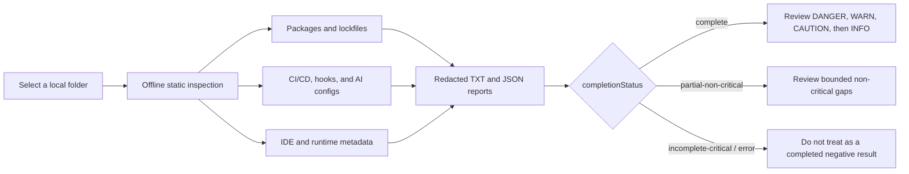

# Dev Supply Chain IOC Checker

Dependency-free Windows developer environment supply-chain IOC checker.

This tool is a BAT launcher plus a single Windows PowerShell 5.1-compatible scanner. It performs offline, read-only static checks against project files, package metadata, explicitly declared Node.js runtime versions, CI/CD workflows, MCP/AI-agent configs, IDE extensions, and optional endpoint telemetry.

Current scanner version: **0.1.23**. Repository: [Daiki9801/dev-supplychain-checker](https://github.com/Daiki9801/dev-supplychain-checker).

日本語で使い始める場合は、[IT初心者向け使い方マニュアル](docs/user-manual-ja.md)または[図解マニュアル](docs/visual-user-manual-ja.md)を参照してください。

## Safety Model

- No external dependencies.
- No network access or online IOC update.
- No target project code execution.
- No remediation, deletion, uninstall, registry modification, quarantine, or cleanup.
- No secret values are printed to TXT or JSON reports.
- User profile and endpoint telemetry scans are opt-in only.

For distribution and non-technical users, see [Safety Model](docs/safety-model-en.md).

## What This Checker Cannot Prove

An `OK` result, no `DANGER` findings, or even `completionStatus=complete` does **not** prove that a PC or repository is clean. `complete` means only that the checks planned for the selected, bounded scope finished without a recorded coverage gap.

This checker does not:

- scan the entire disk or every file in dependency, build, cache, archive, or binary content;
- inspect memory, live process behavior, network traffic, cloud logs, or remote services;
- perform a complete dependency/CVE audit or prove package, publisher, extension, or binary authenticity;
- obtain live reputation or IOC updates while scanning; or
- confirm infection, rule out compromise, or remediate a finding.

Use severity as triage priority and completion state as coverage information. See [Limitations](docs/limitations.md) for the full boundary.

## Scan Flow



The scanner reads bounded local metadata and text. It does not download repositories, execute target code, or remediate findings.

Report generation is append-only with respect to existing files: explicit `-TextOut` and `-JsonOut` paths must be different and unused. Existing files are rejected before scanning, default filename collisions receive a new suffix, and report writes use create-new semantics.

## Documentation

| Audience | Japanese | English |
|---|---|---|
| First-time users | [Beginner manual](docs/user-manual-ja.md) | [Beginner manual](docs/user-manual-en.md) |
| Visual overview | [Illustrated manual](docs/visual-user-manual-ja.md) | [Illustrated manual](docs/visual-user-manual-en.md) |
| Safety and limits | [Safety model](docs/safety-model-ja.md) / [Limitations](docs/limitations.md) | [Safety model](docs/safety-model-en.md) / [Limitations](docs/limitations.md) |
| Maintainers | [PC pre-push test procedure](docs/pre-push-test-procedure-ja.md) / [Publication checklist](docs/github-publication-checklist-ja.md) / [Contributing](docs/contributing-ja.md) | [Publication checklist](docs/github-publication-checklist-en.md) / [Contributing](CONTRIBUTING.md) |
| IOC maintainers | [Local IOC data](iocs/README.md) | [Local IOC data](iocs/README.md) |

## Usage

Beginner-friendly Japanese manual:

- [IT初心者向け 使い方マニュアル](docs/user-manual-ja.md)
- [図解マニュアル: Dev Supply Chain IOC Checker](docs/visual-user-manual-ja.md)
- [安全性と設計上の約束](docs/safety-model-ja.md)

English manuals:

- [Beginner User Manual](docs/user-manual-en.md)
- [Illustrated Manual](docs/visual-user-manual-en.md)
- [Safety Model](docs/safety-model-en.md)

Scan the current folder:

```powershell
powershell.exe -NoLogo -NoProfile -ExecutionPolicy Bypass -File .\Scan-DevSupplyChain.ps1 -Path . -ReportDir .\reports
```

Run only selected risk checks:

```powershell
powershell.exe -NoLogo -NoProfile -ExecutionPolicy Bypass -File .\Scan-DevSupplyChain.ps1 -Path . -Checks Packages,AiMcp,CiCd -ReportDir .\reports
```

Valid `-Checks` values are:

- `Recommended`: default project-local static checks, including declared/pinned Node.js versions and already-enumerated `node.exe` files. Does not read npm global/cache or search host Node.js locations.
- `MajorRecommended`: `Recommended` plus static npm global package roots and bounded known-path/PATH Node.js installations.
- `AllSafe`: all non-telemetry static checks, including static npm global/cache.
- `Packages`, `LifecycleScripts`, `NodeRuntime`, `InvisibleUnicode`, `CiCd`, `AiMcp`, `IdeExtensions`, `HooksAndTasks`, `SecretsInventory`, `NpmGlobal`, `NpmCache`, `ScannerSelf`.

`InvisibleUnicode` reports an isolated invisible control as `CAUTION` and adds bounded handling for consecutive Variation Selector clusters. It recognizes the known GlassWorm `codePointAt` decoder shape only when the same locally bound code-point variable performs both selector-range checks and byte-offset mappings. A decoder signature without an observed selector cluster is at most `WARN`; unrelated APIs elsewhere in a large bundle are not combined into `DANGER`. The scanner safely maps `U+FE00-U+FE0F` and `U+E0100-U+E01EF` clusters to bytes in memory and checks decoded UTF-8 only for static execution or secret-access markers. Analysis iterates only matched selectors instead of every character; analyzed selector matches and each cluster's static decode buffer are capped at 8,192. Over-limit input records incomplete candidate coverage after a bounded tail-cluster check. Decoded payload text is never executed or copied into reports.

`UserProfile` and `EndpointTelemetry` are still explicit mode switches, not `-Checks` names.

Reports include a machine-readable `scanScope` object and an `iocData` freshness inventory. `scanScope` distinguishes bounded comprehensive triage from Deep or full-disk traversal. `iocData.releaseReady` is `false` whenever a shipped IOC dataset is stale, missing, or invalid; historical exact indicators remain active, but maintainers should refresh the affected data before publishing a release. `releaseReady=true` covers only the documented bounded datasets and never claims that the checker is a complete live threat feed.

Run the single BAT launcher:

```bat
run-checker.bat
```

For a selected folder, menu item `2` now offers `Recommended` or explicit `Deep` traversal. The command form is:

```bat
run-checker.bat deep C:\Path\To\Project
```

Deep traversal requires typing `YES`. It enters dependency, build, and cache directories, but it does not add npm global/cache, UserProfile, or EndpointTelemetry scanning. VCS directories, reparse points, auth-file contents, and the running checker's own reports remain protected.

Deep findings distinguish code selected as an active package lifecycle/runtime entrypoint from code reached only by recursive traversal. Exact IOC/campaign matches and strong behavior in first-party or selected entrypoint code retain `DANGER`. Generic secret-send, developer-tool write, single invisible-Unicode execution, or local WASM decode/process compounds in unselected dependency/generated code are `WARN`; an unselected fetch-execute helper is `CAUTION`. A dependency-owned `.github/workflows` file is not active CI for the consuming repository, so CI-specific checks ignore it while other applicable static code checks still run.

Embedded executable fixtures are scanned as ordinary target content. A filename, test-like function name, helper shape, or fixture-/pattern-like variable or array name does not suppress behavior or IOC text. The running distribution's own synthetic sample bodies are protected only through the bounded manifest/path controls documented below.

PowerShell source receives one narrow context refinement for generic fetch-execute detection. Matches are classified on the original source as `Active`, `Ambiguous`, or `PassiveRegex`; the source text is never rewritten for this decision. A static `Pattern` value is `PassiveRegex` only when its table is literal data, its lexical function scope is independent, every observed value use is a direct `-match`/`-notmatch` consumer, and reachable local helpers cannot recover or execute the value through dynamic scope. An `Active` match always wins over passive definitions and retains its original line number. Parse errors, reflection, wrappers, self-source reads, index/property transfer, execution-oriented use, and unresolved flow remain fail-safe findings. This refinement does not apply to exact IOC or other behavior checks.

For distributed use, run `run-checker.bat` from the extracted checker folder. The folder should contain `Scan-DevSupplyChain.ps1`, `run-checker.bat`, `README.md`, `iocs`, and `tests\samples\manifest.json`. If the launcher sees an incomplete copy, it prints a warning and requires typing `YES` before continuing.

End-user archives should not include the full `tests\samples` fixture tree. This source repository keeps synthetic fixtures for maintainer validation, but GitHub-generated source archives exclude fixture bodies through `.gitattributes` and keep only the sample manifest/readme needed for distribution self-checks.

Non-interactive synthetic validation can call the launcher with a path and no pause:

```bat
run-checker.bat current .\tests\samples\clean-js --no-pause
```

This validation command requires a maintainer source checkout that includes fixture bodies. It is not expected to work from an end-user archive that intentionally omits those fixtures. Omitting fixtures from the archive does not change scanner rules, IOC data, report generation, or real target scanning.

The `major`, `userprofile`, and `full` launcher modes ask for explicit confirmation before scanning broader real-PC, user-profile, or endpoint data:

```bat
run-checker.bat major
run-checker.bat userprofile
run-checker.bat full C:\Path\To\Project
```

`major` scans common developer folders plus IDE and AI-agent metadata. Project-root discovery includes common GitHub/Documents/Desktop subfolders, JetBrains/Android Studio/Eclipse/NetBeans default project roots, and `OneDrive`, `OneDriveCommercial`, or `OneDriveConsumer` project subfolders when those environment variables resolve to a child directory under `USERPROFILE`. It also performs static npm global metadata checks and bounded Program Files, local process-PATH, and version-manager Node.js file-metadata checks. For Codex, this mode selects active config, agent/rule/skill content, installed plugin tooling, and extension roots; it excludes `.codex\sessions`, runtime cache, and history data. It does not scan the whole user profile or `C:\` drive and does not include endpoint telemetry.

`full` is a bounded comprehensive host-triage profile. It combines the explicit target, MajorLocations discovery, user-profile AI/IDE configuration, static npm global/cache checks, known-path/PATH Node.js metadata, and endpoint telemetry. It is not a full-disk scan and does not enable Deep dependency/build/cache recursion. Run `deep` separately against a trusted project when that recursive content is required.

Automatic roots read from `CODEX_HOME`, `CLAUDE_CONFIG_DIR`, `OneDrive`, `OneDriveCommercial`, and `OneDriveConsumer` are accepted only as absolute, non-reparse child directories under `USERPROFILE`. Relative paths, profile or filesystem roots, profile-external paths, and reparse-point paths are skipped with `AUTOMATIC_ENVIRONMENT_ROOT_REJECTED`. Scan an intentional external configuration or project directory explicitly with `-Path` instead.

User-profile discovery includes common VS Code-compatible extension roots and active configuration for Codex, Claude, Cursor, Windsurf, Continue, Gemini, OpenCode, and user-level `mcp.json`. Known auth/credential files are inventoried without reading their contents. Other in-scope configuration text is read for static matching, while secret-like report evidence passes through central redaction. Project scans also prioritize active AI instruction files such as `AGENTS.md`, `CLAUDE.md`, `.cursorrules`, Cursor rules, and GitHub Copilot instruction files.

Recommended project scans discover bounded child projects under a selected parent (depth 4; Deep depth 8) and apply targeted npm, Python, and Composer checks to each discovered dependency environment. Structural lockfile coverage includes `package-lock.json`, `npm-shrinkwrap.json`, `pnpm-lock.yaml`, Yarn/Bun text locks, and `Pipfile.lock`. Targeted dependency files are capped at `min(10,000, floor(MaxFiles * 0.5))` and divided fairly across discovered projects with a 2,000-file per-project ceiling, so a parent-folder scan cannot let the first few large `node_modules` trees consume the run. Deep remains a separate, intentionally broader mode for one trusted project.

The October 2026 supplement adds bounded incident candidates: at most eight fixed files per npm package (16 total including existing metadata/entrypoint candidates); UTF-8 `.dist-info/METADATA` headers limited to 128 KiB and 1,024 lines, stopping before descriptions; and at most eight `RECORD` runtime paths per selected Python distribution. Python package names normalize case and runs of `.`, `_`, and `-`. Python versions follow PEP 440, including short releases such as `3.0` and `24.0`; equivalent spellings and release zero padding normalize for IOC lookup, while epoch, pre/post/dev, and local suffixes remain distinct. Duplicate or folded identity headers, malformed headers, and invalid versions preserve critical incomplete coverage. `memoryos` maps to `memos` runtime files without importing them. Hash comparisons share one hash calculation per file inspection; binary content is not parsed as text.

Python `Pipfile.lock` exact pins and literal `name`/`version` fields in a single Poetry/uv `[[package]]` block provide lockfile evidence. Names and versions from separate blocks, nested tables, comments, or multiline strings are not combined. Unclosed strings and invalid/duplicate identity fields preserve critical incomplete coverage. Other Python manifest/constraint text remains reference evidence; this is bounded static matching rather than a full TOML or dependency resolver.

`LifecycleScripts` evaluates GYP condition scalars statically, including bounded Unicode/hex escapes (131,072 UTF-16 code units per file, 65,536 per scalar, 64 conditions, and depth 32), and correlates credential access, encoding, and DNS query arguments in local windows. Active/selected code can produce `DANGER`; unselected dependency or generated code is capped at `WARN`. A sckit/stage0/configuration loader compound is `WARN` unless a known hash or exact package version independently matches. No GYP condition, package import, decoder payload, or DNS query is executed.

`CiCd` selects local workflow scripts and one literal `BASH_ENV` bridge hop (eight script candidates per project), then checks credential-derived transfers. Campaign-destination flows on the selected bridge can be `DANGER`; normal npm/PyPI publishing is not classified as exfiltration by this rule. GitHub Action advisory tags produce a reference-version `WARN`, unresolved major tags/branches/SHAs produce `INFO`, and verified bad commit hashes remain `DANGER`. A patched numeric tag does not authenticate the mutable remote artifact.

`IdeExtensions` selects bounded extension metadata and at most three fixed/main/browser payload files per extension, including reported `out/extension.js` or `app.js` artifacts. An explicitly selected VSIX/ZIP can be hash-checked; arbitrary archives are not expanded for this supplement. The two new theme IDs are `INFO` watchlist context across registries, while exact artifact hashes provide stronger evidence. Conversation/tool-result forwarding to a reported additional destination is `WARN`; an ordinary user-configured API call alone is not reported by the new transfer rule.

New findings may carry `ruleId`, `sourceId`, and `upstreamSeverity` in TXT and JSON. Selection, analysis-limit, hash, and Python-header counters appear in `scanStats`. Required candidate failures preserve incomplete coverage. These bounded static heuristics do not perform complete language/dataflow analysis; indirect calls, dynamic paths, encryption, complex control flow, and unsupported syntax can require manual review.

Long scans use compact progress by default: one aggregate heartbeat about every 30 seconds plus a root-complete line, showing the redacted root, queued/scanned counts, and elapsed time without printing every current file or scanner stage. Pass `-VerboseProgress` directly to `Scan-DevSupplyChain.ps1` when five-second, per-file, large-file-stage, and slow-step diagnostics are needed; `-Quiet` still suppresses progress output. Finding line numbers are counted in 64 KiB native string chunks rather than per-character PowerShell loops. Targeted npm runtime entrypoints exclude non-executable `.d.ts`/`.d.mts`/`.d.cts` declarations and source maps while retaining package metadata and executable entrypoints. BOM-less UTF-16 detection examines a bounded 64 KiB prefix before decoding the complete text, and common binary extensions, including OCR `.traineddata` and CMS signature `.p7s`, skip text parsing only after exact hash and relevant artifact-metadata checks. A required hash candidate over the size limit still makes coverage critically incomplete. Windows PowerShell 5.1 remains supported.

Every full-text regular-expression operation has an explicit two-second .NET timeout; a process-wide default remains as defense in depth for short metadata and path checks. The timeout is per operation, not a total scan time limit. If one operation encounters pathological input, the scanner skips only that operation for that file, records `REGEX_SCAN_TIMEOUT`, and continues with other checks and files. That operation was not completed, so the run cannot be `complete`: it becomes `partial-non-critical` for a non-critical candidate or `incomplete-critical` when the affected file is a critical candidate such as a lockfile or active configuration. Target text is not included in the timeout message. Narrow the target or review the named file manually; do not treat raising the timeout as proof of safety.

The launcher also provides risk-specific modes for package/Node-runtime, AI/MCP/IDE-only, CI/CD-only, and npm global/cache static checks. The package, AI/MCP/IDE, and CI/CD modes keep the cross-cutting `InvisibleUnicode`/GlassWorm check enabled. Custom menu item `8` accepts project-local checks only; use confirmed modes `6`, `7`, or `9` for npm or broader host scope. The npm static mode reads bounded candidate folders only; it does not execute `npm root -g`, `npm cache ls`, `node`, or package scripts.

GitHub repositories are not downloaded by this tool. To check a GitHub repository, manually obtain a local copy using your normal approved process, then scan that local folder with `-Path` or `run-checker.bat path`.

## Reports

Reports are written as UTF-8 with BOM:

- `dev-supplychain-report-YYYYMMDD-HHMMSS.txt`
- `dev-supplychain-report-YYYYMMDD-HHMMSS.json`

Findings use `DANGER`, `WARN`, `CAUTION`, `INFO`, and `OK`. `CAUTION` sits between `WARN` and `INFO` for low-signal presence, capability, or posture findings that merit review but do not contain a strong malicious compound. `WARN` and `CAUTION` both retain exit code `1`; `DANGER` remains `2`, scanner errors `3`, invalid arguments `4`, and `INFO`/`OK`-only runs `0`.

TXT reports also show:

- `PathType`: whether the path is a file, directory, virtual target, or unknown.
- `Line`: the line number when a text finding can be located safely.
- `SourceContext`: `normal`, `synthetic-sample`, `scanner-self`, `scanner-artifact`, `scanner-artifact-sample`, `scanner-artifact-untrusted`, `cache`, `dependency-metadata`, `active-ai-config`, `executable-tooling`, `reference-text`, `session-log`, `cache-data`, `plugin-metadata`, `jetbrains-plugin`, or `node-runtime`.

JSON reports include `scanStats` with observed files, run-wide unique queued files, child-project discovery, targeted dependency budget use, Deep-only traversal, JetBrains archive inspection, Node.js runtime candidates/version evidence, synthetic sample skips, bounded npm cache status, mutable GitHub Action refs, and WASM artifact counts.
They also include `completionStatus`, `coverage.summary`, `selectedChecks`, `expandedChecks`, `skippedChecks`, `summaryByCheck`, `checkStats`, `summaryBySourceContext`, `priorityFindings`, `capabilitySummary.provenance`, `nodeRuntimeAssessment`, `scanner.severityOrder`, `scanner.cautionExitCode`, `scanner.scriptPathRedacted`, `scanner.launcherPathRedacted`, and `scanner.distributionStatus`. `coverage.summary` separates critical and non-critical failures, labels dependency/cache coverage, and provides the next bounded action. `completionStatus` is `complete`, `partial-non-critical`, `incomplete-critical`, or `error`; the existing `scanComplete` Boolean remains for compatibility and strict completed-negative-result checks.

v0.1.15 adds `traversalComplete`, `directoryCoverageComplete`, `candidateCoverageComplete`, and `scanComplete`. As of v0.1.21, treat a no-finding report as a fully completed bounded negative result only when `scanComplete` is `true` and `completionStatus` is `complete`. A non-critical skip can produce `partial-non-critical` even when the planned critical candidate scope completed. Budget exhaustion, malformed critical lockfiles, unsupported `bun.lockb`, or access/read failures are reported with the affected coverage area without attempting elevation.

`traversalComplete=false` does not by itself mean a critical candidate was missed. If all recorded gaps are explicitly non-critical, such as a bounded selector or regex analysis limit, `completionStatus` is `partial-non-critical`; `coverage.summary.criticalFailures` and `candidateCoverageComplete` identify critical candidate gaps. Run-wide `MaxFiles` exhaustion remains critical because the unenumerated remainder is unknown.

`NodeRuntime` keeps upstream advisory severity separate from scanner severity. A static Critical/High version match is `WARN` (or `INFO` for `engines.node` constraints), never `DANGER` from version text alone. Explicit project/container `HIGH` matches are included in `priorityFindings` alongside installed-runtime matches, with a three-item Node.js cap. JSON keeps the vulnerable-only `nodeRuntimeSummary` for compatibility and adds `nodeRuntimeAssessment`, which separately counts installed binaries and project references and records evaluated exact versions in a bounded, path-redacted inventory. `notAffected` means only that the exact version did not match the shipped offline advisory baseline; it is not a complete CVE, EOL, signature, or publisher-authenticity verdict. Project-local `Recommended` scans read version declarations and already-enumerated `node.exe` metadata without searching host locations. `MajorRecommended`, `AllSafe`, MajorLocations, and UserProfile host scopes additionally inspect bounded known-path, local process-PATH, and version-manager `node.exe` file metadata. The scanner never executes Node.js, queries the registry, or verifies binary authenticity.

Every finding includes `check` and `detectionMethod` so a report can show whether a result came from package metadata, lifecycle/static code scanning, CI/CD text scanning, AI/MCP config scanning, static npm global roots, npm cache metadata, or inventory-only checks.

`.codex` files are not ignored. The scanner separates active configs and executable tooling from reference text, session logs, cache data, and plugin metadata. Unpinned execution in an active MCP config remains `WARN`; passive tooling capability and executable-looking reference examples are `CAUTION`; active fetch-execute or secret-exfiltration compounds remain `DANGER`. Capability provenance labels are path-derived context, not independent publisher verification.

## Local IOC Updates

The scanner uses a small built-in IOC baseline plus optional local JSON files under `iocs/`.
These files are offline data only; the scanner does not fetch or refresh IOC data from the internet.

The current local baseline includes manually reviewed indicators for Axios/plain-crypto-js, GlassWorm/GlassWASM/OpenVSX, recent AsyncAPI/Jscrambler/Injective and related npm incidents, Python hook campaigns, compromised GitHub Action refs, selected C2 or persistence markers, a bounded Node.js runtime advisory set (official Critical releases from 2020 onward plus the maintained recent-High window), and the fixed 2026-08 Keyv ChainDrop campaign snapshot.

The supplement reviewed on 2026-10-06 adds 20 exact package/version pairs, 16 artifact hashes, Mini Shai-Hulud Action references, the conflibot `CVE-2026-55158` reference advisory, two theme ID watchlists, and four contextual endpoint markers. A subsequent [complete bounded corpus comparison](docs/ioc-maintenance-20261006-ja.md) reviewed all seven datasets on that date with unchanged 30-day expiry contracts, removed two inaccurate Jscrambler wrapper pairs, and fixed payload path selectors. Readiness concerns the documented corpus review and integrity; it does not independently reverify every retained historical artifact. See the [item-level evidence](docs/ioc-maintenance-20261006-evidence.json), [implementation plan](docs/security-update-20261006-detailed-implementation-plan-ja.md), and [local IOC guidance](iocs/README.md).

The Windows PowerShell 5.1 synthetic runner is `tests/Test-SecurityUpdate20261006.ps1`; it retains create-new artifacts under `reports`. See the [initial implementation validation record](docs/security-update-20261006-validation-ja.md) for the tested scope and performance comparison.

`tests/Test-PythonMetadataRegressions.ps1` additionally verifies PEP 440 identities, malformed/bounded headers, Python lockfile precision, the reported PC metadata layout, and binary/hash coverage using repository-local synthetic files only. See the [2026-10-08 review and validation record](docs/python-metadata-review-20261008-ja.md) for the fixes and remaining coverage limits.
The Keyv snapshot contains 443 package names and 2,235 exact package/version pairs plus bounded hash, marker, persistence, workflow, and propagation checks. Exact installed/structural-lock matches and exact hashes are high-priority evidence; manifest/cache/fallback mentions and markers require corroboration. All 2,235 pairs were independently corroborated in non-withdrawn OSV malware records on 2026-10-06. Original supplied-source provenance and the canonical digest remain unchanged; see [Local IOC Data](iocs/README.md) for the separate source CSV and aggregate-count limits.
For mass supply-chain campaigns, add only individually verified package or extension versions. Do not paste incomplete news-derived package lists into the IOC files. Broad campaign names such as TanStack, Mistral, and Red Hat npm families are treated as low-confidence context unless an exact bad version or strong behavior chain is also present.

See [Local IOC Data](iocs/README.md) before updating IOC JSON.

## Public Repository Safety

This repository includes GitHub publication support files:

- `.github/workflows/validate.yml`: parser, JSON, and synthetic-sample validation on Windows.
- `.github/dependabot.yml`: GitHub Actions update PRs only.
- `.github/CODEOWNERS`: active ownership rules for `@Daiki9801`; forks must replace the owner before enabling Code Owner review.
- `.github/ISSUE_TEMPLATE/`: public bug-report guidance that explicitly rejects secrets and host forensic data.
- `.github/pull_request_template.md`: safety and synthetic-validation checklist for contributions.
- `.gitattributes`: excludes the default `reports/` output, local reference files, temporary secrets, and synthetic fixture bodies from generated source archives; custom report directories must remain untracked.
- `SECURITY.md`: vulnerability reporting scope and safety expectations.
- `CONTRIBUTING.md`: contribution and validation rules.
- `CHANGELOG.md`: user-visible scanner changes beginning with v0.1.15.
- `docs/pre-push-test-procedure-ja.md`: ordered Windows PowerShell 5.1, synthetic, optional real-host, report-safety, and Git publication checks.
- `docs/github-publication-checklist-ja.md` / `docs/github-publication-checklist-en.md`: recommended GitHub settings for a public repository.

Japanese companion docs are also available for [security policy](docs/security-policy-ja.md) and [contribution rules](docs/contributing-ja.md).

The workflow uses synthetic samples only. It must not run real `-UserProfile`, `-EndpointTelemetry`, npm, git clone/fetch/pull, node, python, or network retrieval commands.

## Validation

Only run synthetic validation against `tests/samples` unless a human explicitly asks for real host scans.

```powershell
powershell.exe -NoLogo -NoProfile -ExecutionPolicy Bypass -File .\Scan-DevSupplyChain.ps1 -Path .\tests\samples -ReportDir .\reports
```

The `tests/samples` directory contains hand-written synthetic fixtures for source-level regression tests. They were not downloaded, are not real malware, and are expected to produce `CAUTION`/`WARN`/`DANGER` findings when scanned directly. Parent-directory and Major PC scans skip only manifest-verified fixture files matching the currently running checker distribution. Unrelated projects named `tests/samples`, unknown sample files, modified sample files, and fake scanner folders are scanned normally.

Test-only redirection of Node.js/npm host roots requires the explicit `-SyntheticValidation` switch and an existing root under this checkout's `tests/samples` or `reports` directory. Ambient test-root environment variables are ignored during normal scanner use and cleared by `run-checker.bat`.

For non-technical users, distribute an archive that omits the fixture bodies and keeps only `tests\samples\manifest.json` plus `tests\samples\README.md`. This repository's `.gitattributes` applies that rule to GitHub-generated source archives.

Tradeoff: users of the lightweight archive cannot run the synthetic sample regression scan because the intentionally suspicious fixture files are absent. Maintainers and CI still run those checks from the full source repository, so real detection capability is not reduced.

The configured report directory (default: `reports/`) and the current TXT/JSON output files are skipped during normal scans. This prevents current report output from being re-detected as target risk without hiding unrelated source directories such as `reports-service`. Only the repository-root `/reports/` directory is ignored by Git; custom or legacy report directories must be reviewed explicitly before commit. Scan a report folder explicitly with `-Path` only when reviewing report contents intentionally.

## Important Limits

Completion and severity answer different questions:

| Field or result | Correct interpretation |
|---|---|
| `DANGER` | High-priority evidence to review; not automatic proof of infection. |
| No `DANGER` | No high-priority match was found in completed checks; not proof of safety. |
| `complete` | The selected bounded scan plan completed; not full-disk or exhaustive coverage. |
| `partial-non-critical` | A declared non-critical check or bounded analysis was skipped or limited. Review `coverage.summary` and the limitation finding. |
| `incomplete-critical` / `error` | Material coverage or scanner execution is unknown. Do not use the result as a completed negative. |

This is a triage tool. It does not replace EDR/AV, memory or network forensics, package-manager audit services, SIEM review, or incident response.
