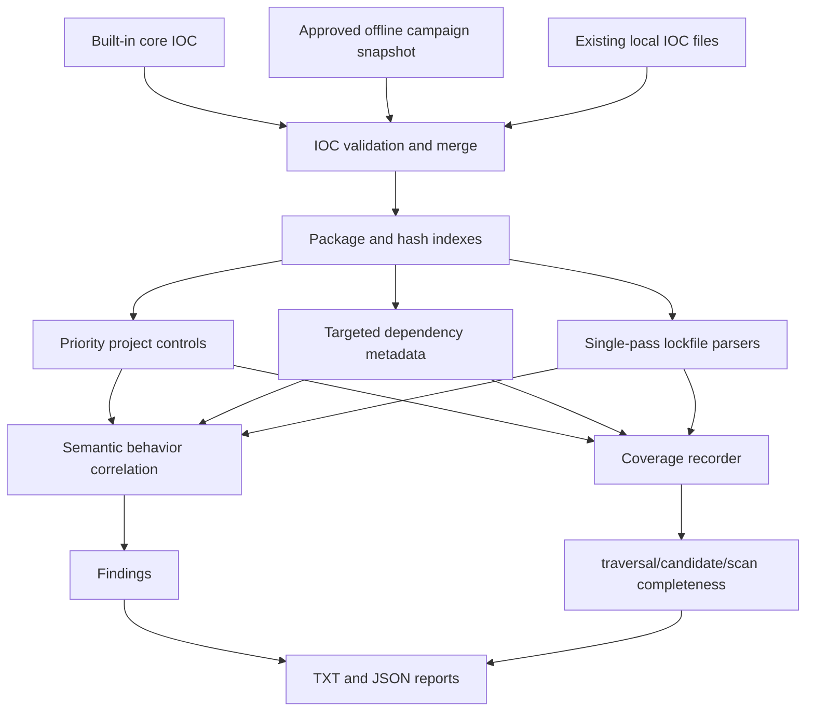

# Keyv / ChainDrop 対応 v0.1.15 詳細実装プラン

- 文書状態: 実装前レビュー済み案
- 作成日: 2026-08-12
- 対象ベースライン: Dev Supply Chain IOC Checker v0.1.14
- 想定更新版: v0.1.15
- 対象インシデントID: `keyv-chaindrop-2026-08`
- 対象成果物: `Keyv-ChainDrop-NonDestructive-Check-v1.2.2.bat`
- 参照レポート: `KEYV_CHAINDROP_RESPONSE_AND_CHECKER_IMPROVEMENT_REPORT_2026-08-12_UPDATED.md`

## 1. 目的

本書は、Keyv / ChainDrop npmサプライチェーン攻撃について単独BATチェッカーで得られた知見を、既存の `dev-supplychain-checker` へ安全に統合するための詳細実装計画である。

単独BATのコードをそのまま移植するのではなく、次の価値だけを既存アーキテクチャへ取り込む。

1. レビュー済みのexact package/version IOCと既知ファイルhash。
2. 単語の共起ではなく、資格情報窃取、npm自己増殖、IDE/AI設定永続化を表す意味的相関。
3. PowerShell 5.1で大規模 `package-lock.json` を安定して扱う限定構造解析。
4. 重要candidateの未読を `OK` に埋没させないcoverage契約。
5. esbuild、sharp、Qwen、正規release automationなどを攻撃と誤認しない回帰試験。

本更新後も、ツールは依存なし、オフライン、読み取り専用、Windows PowerShell 5.1互換を維持する。

## 2. 今回のレビューで確認した事実

添付BATは実行せず、静的に次を確認した。

| 項目 | 確認値 |
|---|---|
| BAT SHA-256 | `fe3f4d4e890899bd7f748d02ac12db03832e99a0d31a2ee37a108663e857095b` |
| 埋め込みPowerShell parser error | 0 |
| package数 | 443 |
| package/version pair数 | 2,235 |
| 正規化IOC SHA-256 | `7da86fddcb4bc5c4352d3f2120903a07314ae2ce3071d980061862bcbc8aa497` |
| 代表的IOC候補 | `keyv@6.0.0`, `flat-cache@6.1.24`, `file-entry-cache@11.1.6` |

添付レポートに「v1.2.1作成時 SHA-256」と記載された値は、実際のv1.2.2 BATのSHA-256と一致する。実装とは別に、レポートの版表記は訂正対象である。

ただし、上記は添付BAT内部とレポートの整合性を示すだけであり、IOCの外部的な真正性を証明しない。このリポジトリの作業ではネットワーク取得が禁止されているため、Wiz CSV、Aikido、Socket等の公開情報との再照合は実施していない。

従って、443 package / 2,235 pairと3件のhashをproduction IOCとして取り込む前に、人間が別の承認済み手段で出典と内容を確認する必要がある。

## 3. 現行v0.1.14の評価

### 3.1 既に利用できる機構

現行実装には、今回の統合に再利用できる機構がある。

- built-in IOCと `iocs/*.json` のローカルIOC読込。
- installed package、project manifest、lockfile、npm global、npm cache metadataの検査。
- `setup_bun.js`、`bun_environment.js`、`actionsSecrets.json`、`truffleSecrets.json` などShai-Hulud系marker。
- lifecycle scriptとpackage entrypointの限定的なtargeted scan。
- 資格情報参照と外部送信、外部取得と実行、developer tool設定書込の相関関数。
- GitHub Actionsの `toJSON(secrets)` とartifact upload検出。
- manifestとhashで検証したsynthetic fixtureだけを親スキャンから除外する機構。
- `DANGER / WARN / INFO / OK`、finding contract、TXT/JSONレポート、exit code契約。

### 3.2 未統合の検出面

現行実装には次がない。

- Keyv / ChainDropの443 package / 2,235 exact pair。
- `keyv@6.0.0` 等の中核built-in fallback。
- `setup.mjs`、`Math_Symbol.js`、`math_init.js` の既知hash。
- `npm-cache.com` 等のcampaign marker候補。
- npm auth、package改変、所有package列挙、publishを結ぶ自己増殖判定。
- `.vscode/tasks.json` の `runOn: folderOpen` とincident loaderの相関。
- `.claude/settings.json` の `SessionStart` とincident loaderの相関。
- campaign固有のGitHub Actions artifact/workflow marker。
- 重要candidate read failureを最終結果へ反映するcoverage契約。
- PowerShell 5.1の `ConvertFrom-Json` に依存しない、安全な `package-lock.json` オブジェクト境界解析。

## 4. 前回プランのレビュー結果と改善

### 4.1 大量IOCは既存ループへ単純追加しない

現行の一部処理は、各ファイルに対して全package IOCと全versionを順にregex検索する。443 package / 2,235 pairを単純追加すると、lockfileとnpm cache metadataで概ね `IOC数 × ファイルサイズ` の処理になり、性能劣化とregex誤結合の原因になる。

改善方針:

- IOC load完了後に、ecosystem、正規化package名、exact versionをキーにしたindexを構築する。
- lockfileは1回だけ構造走査し、抽出したpackage/versionをindexへ照会する。
- npm cache metadataも、package/version候補を1回抽出してindexへ照会する。
- 同じpackage/versionがbuilt-inとlocal IOCの両方にあっても、index構築時に統合し、findingを重複させない。

### 4.2 npm自己増殖DANGERをさらに厳格化する

単独BATの次の条件は、従来の単語共起より良いが、正規release scriptとも衝突し得る。

```text
npm auth
  + publish
  + package mutation または ownership enumeration
```

正規release automationも `NPM_TOKEN`、version更新、`npm publish` を同時に持つことがある。この組合せだけを `DANGER` にしてはならない。

改善後の `DANGER` 条件:

```text
npm auth
  + publish operation
  + package mutation
  + 次のいずれか
      - ownership/package enumeration
      - 複数packageを反復する自己複製構造
      - exact campaign marker
      - exact compromised package context
```

`NPM_TOKEN + version bump + npm publish` だけの場合はChainDrop DANGERにしない。既存のCI posture WARN等が該当する場合は、その既存findingだけを維持する。

### 4.3 package-lock解析はオブジェクト境界を追跡する

単独BATはpackage名の後方4KBから最初の `version` を取得する。この方式は、大規模lockfileのPowerShell 5.1問題を回避できる一方、壊れたJSONや特殊な入れ子で別オブジェクトのversionを誤結合する可能性がある。

改善方針:

- JSON string、escape、`{}`、`[]`、`:`, `,` を認識する限定tokenizerを実装する。
- `packages` と `dependencies` の対象オブジェクト境界内にある直接の `version` だけを対応付ける。
- 完全な汎用JSON parserは作らない。
- token上限、nesting上限、入力サイズ上限を設ける。
- 構造が不正な場合はDANGER判定を推測せず、bounded text fallbackを `WARN` 上限で使用する。

### 4.4 hash coverageを正確に表現する

既知hashは、scannerが到達したcandidateにしか適用できない。`node_modules` 全ファイルを再帰hashする設計にはしない。

改善方針:

- package rootでincident filename 3種を固定候補として確認する。
- lifecycle、VS Code task、Claude hookから安全に解決できたlocal scriptを追加候補にする。
- レポートでは「全ファイルでhash一致なし」ではなく、「列挙・解決されたhash candidateで一致なし」と表現する。

### 4.5 coverageは失敗の重要度を検出面から決める

単独BATの「特定のディレクトリ名ならcritical」という方式だけでは、`node_modules` 配下のpackage directoryや名前の異なる開発rootで起きた失敗を正しく分類できない。

改善方針:

- 列挙・候補化時に `scopeRole` と `candidateKind` を付ける。
- 名前だけでなく、どのcheckのどの検出面が未確認になったかでcriticalを決める。
- 非重要な一時ディレクトリの失敗は集約INFOにできる。
- lockfile、installed `package.json`、lifecycle参照script、IDE/AI自動実行設定、workflowなどの失敗はcoverage WARNにする。

### 4.6 UAC昇格は本体へ統合しない

単独BATの管理者限定再検査は明示Y確認付きだが、本体の安全モデルと実ホスト読取承認ゲートを複雑にする。

本体では次を禁止する。

- `Start-Process -Verb RunAs`
- 自動昇格、自己再起動
- `takeown`, `icacls`, `Set-Acl`
- 所有権、ACL、属性の変更

同一権限での読み取り専用再試行は、明示されたscan root内に限定し、最大1回まで許容する。解決しなければcoverage WARNとして終了する。

## 5. 更新後も維持する安全境界

次は実装全phaseの非交渉条件である。

- Windows PowerShell 5.1互換。
- BAT launcher + 単一main PowerShell scanner。
- 外部依存なし。
- ネットワーク通信なし。
- npm、pnpm、yarn、bun、node、python、git等のtarget toolを実行しない。
- target project code、lifecycle、hook、workflowを実行しない。
- secret/auth fileの内容を読まない。
- finding evidenceへsecret値や環境変数値を出さない。
- targetを削除、隔離、修復、変更しない。
- 実マルウェアsampleをリポジトリへ置かない。
- reparse pointを追跡しない。
- 実ホスト検証を自動実行しない。
- `Recommended` のproject-local scopeを拡大して実ホストknown pathを読むことはしない。

## 6. 対象外

v0.1.15では次を実装しない。

- Git commit/object/historyの完全解析。
- GitHub audit log、Actions run、artifact、npm publish履歴の取得。
- EDR、SIEM、DNS、process memory、active socket等のフォレンジック。
- credential rotation、package削除、quarantine、cleanup。
- online IOC updater。
- package managerによる解決済みversion確認。
- 全 `node_modules` の無制限再帰・全ファイルhash。
- incident専用BAT launcherの追加。

## 7. 目標アーキテクチャ



設計上、exact IOC、behavior、coverageは別の証拠層として保持する。package名だけをbehavior DANGERへ昇格させたり、behaviorだけでexact IOCと表現したりしない。

## 8. IOCデータ設計

### 8.1 新規ファイル

新規追加候補:

`iocs/campaign-keyv-chaindrop-20260806.json`

ファイル名はloaderで明示的にallowlistする。`campaign-*.json` のような無制限glob loadは行わない。

### 8.2 推奨schema

```json
{
  "schemaVersion": "1",
  "campaignId": "keyv-chaindrop-2026-08",
  "lastReviewed": "2026-08-12",
  "reviewAfterDays": 30,
  "sourceSet": [
    {
      "name": "reviewed-package-snapshot",
      "url": "https://example.invalid/source-metadata-only",
      "retrievedAt": "2026-08-12",
      "sha256": "64-hex-placeholder"
    }
  ],
  "integrity": {
    "normalization": "lowercase-name|sorted-exact-versions; LF; UTF-8 without BOM",
    "sha256": "64-hex-placeholder",
    "packageCount": 443,
    "packageVersionPairCount": 2235
  },
  "packages": [],
  "files": [],
  "domains": [],
  "patterns": [],
  "gitRefs": []
}
```

上記URLはschema例であり、実ファイルには承認済みの実出典metadataを記録する。scannerはURLへアクセスしない。

### 8.3 loader validation

`Load-KeyvChainDropCampaignIocs` を新設し、次を検証する。

- `schemaVersion` と `campaignId` が完全一致する。
- package名は空でなく、正規化後も同一である。
- versionはexact `major.minor.patch` と必要なprereleaseだけを許可する。
- range、tag、`latest`、wildcardをcampaign exact IOCへ入れない。
- 同一package/version pairの重複を拒否する。
- package数とpair数がheader値に一致する。
- 規定canonical projectionのSHA-256がheader値に一致する。
- file hashは64桁hex。
- regexはload時にcompile可能である。
- path patternは絶対pathを強制せず、既存のcandidate pathへだけ適用する。

異常時はcampaign file全体を無効化し、部分的に信頼しない。built-in core fallbackは維持し、`CAMPAIGN_IOC_DATA_INVALID` を `WARN` で出す。

### 8.4 built-in fallback

全443 packageをscanner本体へ重複埋め込みしない。人間の出典承認後、次の中核候補だけをbuilt-in fallbackへ入れる。

- `keyv@6.0.0`
- `flat-cache@6.1.24`
- `file-entry-cache@11.1.6`
- `cacheable@2.5.1`
- `@cacheable/memory@2.2.1`
- `@cacheable/net@2.1.1`
- `@cacheable/node-cache@3.1.2`
- `@cacheable/utils@2.5.1`

この一覧は添付BATから抽出した中核候補であり、production実装前に個別承認する。未承認entryはbuilt-inへ入れない。

候補hash:

- `54dc7ea54a1317cca0e890a2770630cf7fa6c97813e0cb9d2caa93012b350668`
- `fd3ca4007b225fdf8de7af4345a19179d5efa8c4bb9205f88cda806e5684b1eb`
- `9fc2570b7cef51c1b8df116d144d11ff4096357be7d2c4c6367cfc2509cf1bcc`

hashも同様に出典承認後のみproduction baselineへ入れる。

### 8.5 staleness

exact historical IOCはreview期限を過ぎても無効化しない。期限は「悪性versionの失効」ではなく「snapshotが最新か再確認すべき時期」を表す。

- 期限内: 通常load。
- 期限超過: IOCをloadし続け、`CAMPAIGN_IOC_DATA_STALE` を `WARN`。
- missing/invalid: core fallbackのみ、`CAMPAIGN_IOC_DATA_MISSING` または `CAMPAIGN_IOC_DATA_INVALID` を `WARN`。

### 8.6 index

`Finalize-IocIndexes` を追加し、local IOC load完了後に1回だけ実行する。

推奨index:

```text
packageIndex[ecosystem][lowercase package name][exact version]
fileHashIndex[lowercase sha256]
domainIndex[lowercase domain]
```

同一package/versionをbuilt-inとcampaign fileが持つ場合は1 entryへ統合する。local IOCはbuilt-in severityを下げられない。conflict時は高いseverityを維持し、data conflictを集約WARNにする。

## 9. package/version検出設計

### 9.1 evidence別severity

| Evidence | Severity | 理由 |
|---|---|---|
| `node_modules/**/package.json` exact | DANGER | installed treeにexact versionが存在 |
| static npm global package exact | DANGER | global install metadataに存在 |
| package-lock/pnpm/yarn exact resolution | DANGER | lockfileで解決versionが固定 |
| npm cache metadata exact | WARN | cache存在はinstall/executionの証明ではない |
| project root own manifest exact | WARN | source checkoutや未公開sourceの可能性 |
| dependency exact declaration | WARN | install済みversionの証明ではない |
| rangeがbad version文字列を含む | WARN | resolved version未確認 |
| package family/nameだけ | INFO | contextのみ |

現行の `manifest-exact` を一律DANGERにする挙動は見直し、installed/lockfileとmanifest referenceを分離する。既存fixtureとdocsの期待値も同時に更新する。

### 9.2 package-lock v1/v2/v3

新設候補:

- `Get-JsonSubsetTokens`
- `Get-NpmPackageLockEntries`
- `Scan-NpmPackageLockStructural`

要件:

- string escapeとobject/array depthを追跡する。
- v2/v3は `packages` の `node_modules/<name>` keyと同一object直下の `version` を結ぶ。
- v1は `dependencies` のpackage keyと同一object直下の `version` を結ぶ。
- nested `dependencies` はdepth上限内で処理する。
- 最大nesting 128、最大token数は入力サイズからboundedにする。
- object外の近接文字列をpackage/versionとして結ばない。
- malformed inputではexact DANGERを推測しない。

### 9.3 pnpm/yarn/bun

- pnpm: package/snapshot keyをline単位で解析し、同じkeyに含まれるname/versionだけを抽出する。
- Yarn v1: selector headerと同一block内の `version` を対応付ける。
- Yarn Berry: `resolution` 等のsingle-line exact formを限定的に扱う。
- `bun.lock`: text形式として明示的に認識できるentryだけを抽出する。
- `bun.lockb`: binaryであることを記録し、他のinstalled metadataがない場合はcritical candidate coverage failureとする。binaryを推測解析しない。

### 9.4 npm cache

`Scan-NpmCacheTextMetadata` の全IOC regex loopを廃止する。

- npm registry URL、cache key、JSON metadataからpackage/version候補を1回抽出する。
- 抽出結果を `packageIndex` へ照会する。
- cache-only findingはWARNを上限とする。
- 1ファイルあたりの抽出entry数に上限を設ける。

## 10. candidate選定とhash検出

### 10.1 priorityとdependency targetの分離

現行 `Get-TargetedFileList` はdependency targetとproject controlを一つのlistで扱う。v0.1.15では次へ分離する。

- `Get-PrioritySecurityFileList`
- `Get-TargetedDependencyFileList`
- 既存のnormal file list

scan順序:

1. Node runtime priority candidate。
2. security control priority candidate。
3. targeted dependency metadata/entrypoint。
4. normal traversal candidate。

priority candidateもrun-wide `MaxFiles` に従い、scope外ファイルを追加しない。

### 10.2 priority security files

project rootごとに存在確認する候補:

- `.vscode/tasks.json`
- `.claude/settings.json`
- `.github/workflows/*.yml`
- `.github/workflows/*.yaml`
- `setup.mjs`
- `Math_Symbol.js`
- `math_init.js`
- bounded Git metadata IOC path

workflow enumerationは件数上限を設け、reparse pointを追わない。

### 10.3 dependency package root

各targeted npm package rootでは次を候補化する。

- `package.json`
- lifecycleから安全に解決できるlocal script。
- `main`, `module`, `browser`, `bin`, `exports` から既存上限内で選んだentrypoint。
- package root直下の `setup.mjs`, `Math_Symbol.js`, `math_init.js`。

incident filename探索はpackage root直下と明示参照先だけに限定し、無制限再帰しない。

### 10.4 local script解決

共通resolverを作り、lifecycle、VS Code task、Claude hookで再利用する。

拒否条件:

- absolute path。
- URI scheme。
- `..` segment。
- target/project root外へ出るpath。
- path途中のreparse point。
- 許可外extension。

上限:

- 1設定ファイルあたり最大8参照。
- 追跡深度最大2。
- 1参照script最大2MB。

## 11. semantic behavior detection

### 11.1 signalとdecisionの分離

`Get-ChainDropBehaviorSignals` は事実signalだけを返し、`Get-ChainDropBehaviorDecision` がseverityを決める。

signal例:

```text
credentialTarget
credentialRead
broadEnvironmentHarvest
explicitCredentialVariable
externalWrite
exactCampaignMarker
npmAuth
npmPublishCommand
npmRegistryPublishApi
packageMutation
ownershipEnumeration
multiPackageReplicationLoop
vscodeFolderOpenWrite
claudeSessionStartWrite
incidentPayloadReference
knownCompromisedPackageContext
```

signal名、真偽、判定理由はレポートへ安全な定型文で出し、raw codeやsecret値を出さない。

### 11.2 credential exfiltration

`DANGER`:

```text
(
  credentialTarget + actual read
  または broad environment serialization
  または explicit credential variable
)
+ external POST/PUT/PATCH/upload
```

次は単独ではsignalにしない。

- `process.env`
- `child_process`
- `fetch`
- URL文字列
- npm registry URL

外部downloadだけをsecret exfiltrationとしない。送信方向を示すmethod/body/uploadを要求する。

### 11.3 npm propagation

`DANGER`:

```text
npm auth
+ publish command または registry publish API
+ package/tarball mutation
+ ownership enumeration / multi-package loop / exact campaign context のいずれか
```

`WARN`候補:

- incident filenameとBun bootstrapとsupporting signal。
- startup/lifecycleから参照されたincident payload名とcredential/npm signal。

正規release toolingの負例を必須回帰試験にする。

### 11.4 VS Code persistence

`.vscode/tasks.json` について次を構造的に確認する。

- `runOptions.runOn` が `folderOpen`。
- task command/argsがlocal scriptを指す。
- 参照先がincident filename、known hash、またはstrong behavior chainを持つ。

全条件成立で `DANGER`。`folderOpen`だけ、または既知のbenign local taskだけではChainDrop findingを出さない。

### 11.5 Claude Code persistence

`.claude/settings.json` について次を確認する。

- `hooks.SessionStart` が存在する。
- commandがlocal scriptを指す。
- 参照先がincident filename、known hash、またはstrong behavior chainを持つ。

全条件成立で `DANGER`。`SessionStart`だけではChainDrop findingを出さない。

### 11.6 GitHub Actions

既存 `GITHUB_ACTIONS_SECRETS_ARTIFACT_EXFIL_PATTERN` を再利用する。

- `toJSON(secrets)` または同等のbroad secret serialization。
- `actions/upload-artifact` または同等のartifact upload。
- `format-results.txt`、承認済みworkflow名、承認済みbranch markerがあればcampaign corroborationをevidenceへ追加する。

既存DANGERとcampaign DANGERを二重に出さない。campaign markerはconfidence補強情報として同一findingへ統合する。

### 11.7 bounded Git metadata

branch IOCが出典承認された場合だけ、次を静的に検査する。

- exact `.git/refs/heads/<approved-ref>`。
- `.git/refs/remotes/<remote>/<approved-ref>` の限定列挙。
- 4MB以下の `.git/packed-refs`。

次は読まない。

- `.git/objects`
- reflog
- commit body全履歴
- remote network

`.git` 全体の通常skipは維持する。

## 12. finding設計

既存categoryを可能な限り再利用し、incident専用categoryの増殖を抑える。

| 検出 | Category案 | Severity |
|---|---|---|
| installed/lock exact IOC | `KNOWN_COMPROMISED_PACKAGE` | DANGER |
| manifest/cache reference | `KNOWN_COMPROMISED_PACKAGE_REFERENCE` / existing cache category | WARN |
| known campaign hash | `KNOWN_MALICIOUS_FILE_HASH` | DANGER |
| credential exfil chain | `PACKAGE_CODE_SECRET_EXFIL_PATTERN` | DANGER |
| npm worm propagation | `NPM_CHAINDROP_PROPAGATION_CHAIN` | DANGER |
| VS Code folderOpen persistence | `NPM_CHAINDROP_VSCODE_FOLDEROPEN_PERSISTENCE` | DANGER |
| Claude SessionStart persistence | `NPM_CHAINDROP_CLAUDE_SESSIONSTART_PERSISTENCE` | DANGER |
| broad secrets artifact | `GITHUB_ACTIONS_SECRETS_ARTIFACT_EXFIL_PATTERN` | DANGER |
| exact approved Git ref | `NPM_CHAINDROP_GIT_REF_IOC` | DANGER |
| partial incident context | `NPM_CHAINDROP_PARTIAL_CONTEXT` | WARN |
| campaign data missing/invalid/stale | `CAMPAIGN_IOC_DATA_*` | WARN |
| important coverage failure | `SCAN_CANDIDATE_COVERAGE_INCOMPLETE` | WARN |
| noncritical enumeration failure | `SCAN_DIRECTORY_COVERAGE_PARTIAL` | INFO |

すべてのfindingは既存contractを満たす。

- severity
- category
- title
- path
- pathType
- line
- sourceContext
- check
- detectionMethod
- riskType
- confidence
- evidence
- recommendation

## 13. coverage設計

### 13.1 report contract

JSON top-levelへ次を追加する。

```json
{
  "traversalComplete": true,
  "directoryCoverageComplete": true,
  "candidateCoverageComplete": true,
  "scanComplete": true,
  "coverage": {
    "candidateFailures": [],
    "directoryFailures": [],
    "retry": {
      "samePrivilegeAttempts": 0,
      "samePrivilegeResolved": 0,
      "remaining": 0
    }
  }
}
```

定義:

- `traversalComplete`: run-wide/targeted/project discovery等の上限で予定scopeが打ち切られていない。
- `directoryCoverageComplete`: 意図的skipを除き、列挙対象directoryに失敗がない。
- `candidateCoverageComplete`: security-critical candidateまたはそのcontainerに未解決失敗がない。
- `scanComplete`: scanner errorがなく、`traversalComplete` と `candidateCoverageComplete` がtrue。

非critical directory failureだけなら `directoryCoverageComplete=false` になり得るが、`candidateCoverageComplete` と `scanComplete` はtrueを維持できる。その場合はlimitationsと集約INFOへ記録する。

### 13.2 critical candidate

- lockfile。
- `node_modules/**/package.json`。
- exact IOC package rootのmetadata/incident filename。
- lifecycle/startupから参照されたscript。
- known-hash filename candidate。
- `.vscode/tasks.json`。
- `.claude/settings.json`。
- `.github/workflows/*`。
- 承認済みexact Git ref/packed-refs candidate。
- 明示的に有効化されたnpm global/cache root metadata。

### 13.3 failure type

- `access-denied`
- `missing-after-enumeration`
- `too-large`
- `path-too-long`
- `decode-error`
- `parse-error`
- `unsupported-binary-lockfile`
- `enumeration-error`
- `budget-exhausted`

exception messageの全文はreportへ出さない。failure kind、critical、count、最大3件のredacted representative pathだけを出す。

### 13.4 finalization

`Finalize-ScanCoverage` を全scan完了後、`SCAN_COMPLETED` finding追加前に実行する。

- `scanComplete=true`: 既存 `SCAN_COMPLETED` OKを追加。
- `scanComplete=false`: `SCAN_CANDIDATE_COVERAGE_INCOMPLETE` または既存budget WARNを追加し、矛盾するOKを追加しない。
- overall resultは既存 `Get-OverallResult` によりWARN以上になる。

### 13.5 retry

- critical access-denied directoryだけ最大1回。
- 同一process、同一権限、同じnormalized root内。
- `-Force` はhidden item列挙のためだけに使用。
- delayを入れないか、必要でも短い固定値とする。
- UAC、ACL、ownership変更は行わない。

## 14. scanner内部の変更点

### 14.1 追加・変更候補関数

IOC:

- `Load-KeyvChainDropCampaignIocs`
- `Test-CampaignIocHeader`
- `Get-CampaignIocCanonicalHash`
- `Finalize-IocIndexes`
- `Get-ExactPackageIocMatch`

lockfile:

- `Get-JsonSubsetTokens`
- `Get-NpmPackageLockEntries`
- `Get-PnpmLockEntries`
- `Get-YarnLockEntries`
- `Get-BunTextLockEntries`

candidate:

- `Get-PrioritySecurityFileList`
- `Get-TargetedDependencyFileList`
- `Resolve-SafeLocalScriptReference`
- `Add-IncidentFilenameCandidates`

behavior:

- `Get-ChainDropBehaviorSignals`
- `Get-ChainDropBehaviorDecision`
- `Test-NpmPropagationChain`
- `Scan-VscodeFolderOpenPersistence`
- `Scan-ClaudeSessionStartPersistence`
- `Scan-BoundedGitRefIocs`

coverage:

- `Register-CoverageFailure`
- `Test-IsCriticalCandidate`
- `Get-CoverageFailureSummary`
- `Retry-CriticalDirectoryFailures`
- `Finalize-ScanCoverage`

### 14.2 既存関数の変更候補

- `Initialize-ScannerContext`
- `Add-ScanStat`
- `Get-ScanStatsForReport`
- `Load-BuiltinIocs`
- `Load-LocalIocs`
- `Add-KnownPackageFinding`
- `Scan-KnownPackageText`
- `Scan-NpmPackageLockJson`
- `Scan-NpmFiles`
- `Scan-NpmRuntimeCode`
- `Scan-GitHubActions`
- `Scan-HooksAndWorkspaceTasks`
- `Add-NodeModuleTargetedFiles`
- `Get-TargetedFileList`
- `Read-TextFileSafe`
- `Get-SafeFileList`
- `Scan-Project`
- `Write-Reports`

実装時は、新規関数を追加してからcall siteを切り替える。既存関数を一括で全面書換えしない。

## 15. 実装phase

### Phase 0: IOC出典承認

変更前に人間が行う。

1. 443 package / 2,235 pairのsource artifactを確認する。
2. package/versionの重複、取消、訂正情報を確認する。
3. 3 hash、domain、wallet/marker、Git branch、workflow/artifact markerを個別確認する。
4. 承認したsource hash、取得日、reviewerを記録する。
5. 未確認indicatorはproduction snapshotへ入れない。

Gate:

- 承認済みsnapshotがない場合、Phase 1以降はschema・loader・synthetic dataだけ実装し、production IOC値を追加しない。

### Phase 1: campaign IOC schemaとindex

対象:

- `Scan-DevSupplyChain.ps1`
- `iocs/campaign-keyv-chaindrop-20260806.json`
- `iocs/README.md`

作業:

1. campaign loaderとheader/count/hash validationを追加。
2. built-in/local/campaign package IOCを統合するindexを追加。
3. existing package lookupとnpm global lookupをindex経由へ変更。
4. campaign data statusをcontext/reportへ追加。
5. missing、invalid、stale、conflictのfallbackを追加。

Gate:

- local campaign fileがなくてもcore fallbackが機能する。
- malformed local dataがbuilt-inを弱めない。
- 同一exact IOCがfindingを重複させない。

### Phase 2: lockfile単一走査

対象:

- `Scan-DevSupplyChain.ps1`
- lockfile fixtures

作業:

1. package-lock subset tokenizerを追加。
2. v1/v2/v3 object boundary testを追加。
3. pnpm/yarn/bun text parserを追加。
4. current per-IOC lockfile regex loopをindex lookupへ切替。
5. malformed/too-deep/too-large/binaryのcoverage記録を追加。

Gate:

- package名と別objectのversionを誤結合しない。
- exact resolutionだけDANGER。
- fallback textはWARN上限。
- 10,000 entryのgenerated lockfileで全IOC regex反復を行わない。

### Phase 3: priority candidateとhash

対象:

- `Scan-DevSupplyChain.ps1`
- campaign IOC file
- candidate fixtures

作業:

1. priority security listとdependency target listを分離。
2. incident filename 3種をbounded candidate化。
3. common local script resolverを追加。
4. approved production hashをcampaign fileとbuilt-in coreへ追加。
5. hash candidate statsを追加。

Gate:

- reparse/path traversalでscope外を読まない。
- secret inventory fileをscript referenceとして読まない。
- normal project scanでpriority configがdependency bulkより先に処理される。

### Phase 4: semantic behavior

対象:

- `Scan-DevSupplyChain.ps1`
- positive/negative behavior fixtures

作業:

1. signal/decision分離。
2. credential exfilのexternal write要件を厳格化。
3. npm propagationへownership/multi-package/campaign条件を追加。
4. VS Code folderOpenとClaude SessionStartの相関を追加。
5. existing GitHub secret artifact findingへcampaign corroborationを統合。
6. 承認済みの場合だけbounded Git ref検出を追加。

Gate:

- positive chainはDANGER。
- esbuild/sharp/Qwen/release automationはChainDrop DANGERにならない。
- raw secret、env value、script contentをreportへ出さない。

### Phase 5: coverage contract

対象:

- `Scan-DevSupplyChain.ps1`
- report contract tests

作業:

1. failure recorderとcritical classifierを追加。
2. read、parse、enumeration、budget failureを接続。
3. 同一権限retryを最大1回追加。
4. top-level completeness flagsとcoverage summaryを追加。
5. incomplete runで `SCAN_COMPLETED` OKを出さない。

Gate:

- critical unreadable lockfileで `candidateCoverageComplete=false`。
- MaxFiles/targeted budget到達で `traversalComplete=false`。
- incomplete runのexit codeは最低1。
- noncritical failureは集約され、reportを埋め尽くさない。

### Phase 6: documentationとlauncher completeness

対象:

- `run-checker.bat`
- `README.md`
- `iocs/README.md`
- `docs/limitations.md`
- `docs/user-manual-ja.md`
- `docs/user-manual-en.md`
- 必要に応じてsafety model docs

作業:

1. launcherのcomplete distribution確認へcampaign snapshotを追加。
2. snapshot missing時もscanner core fallbackが動くことを説明。
3. hash coverage、lockfile support、coverage flagの意味を記載。
4. `OK` はhost cleanの証明でないことを維持。
5. UACやremediationを追加していないことを明記。

Gate:

- BATはthin launcherのまま。
- 新しいscan modeや実ホストscopeを暗黙追加しない。

## 16. synthetic fixture計画

すべてhand-written synthetic textとし、実マルウェアを置かない。URLは `.invalid`、tokenは名前だけ、値は置かない。

### 16.1 positive

| Fixture案 | 期待category |
|---|---|
| `npm-keyv-installed/node_modules/keyv/package.json` | `KNOWN_COMPROMISED_PACKAGE` |
| `npm-keyv-package-lock-v1/package-lock.json` | `KNOWN_COMPROMISED_PACKAGE` |
| `npm-keyv-package-lock-v3/package-lock.json` | `KNOWN_COMPROMISED_PACKAGE` |
| `npm-keyv-pnpm-lock/pnpm-lock.yaml` | `KNOWN_COMPROMISED_PACKAGE` |
| `npm-keyv-yarn-lock/yarn.lock` | `KNOWN_COMPROMISED_PACKAGE` |
| `npm-chaindrop-exfil/setup.mjs` | `PACKAGE_CODE_SECRET_EXFIL_PATTERN` |
| `npm-chaindrop-propagation/setup.mjs` | `NPM_CHAINDROP_PROPAGATION_CHAIN` |
| `vscode-chaindrop-folderopen/.vscode/tasks.json` | VS Code persistence category |
| `claude-chaindrop-sessionstart/.claude/settings.json` | Claude persistence category |
| `github-actions-chaindrop/.github/workflows/codeql_analysis.yml` | existing secret artifact category |

### 16.2 negative

| Fixture案 | 禁止される結果 |
|---|---|
| `npm-benign-esbuild-installer` | ChainDrop DANGER |
| `npm-benign-sharp-installer` | ChainDrop DANGER |
| `npm-benign-qwen-native-build` | ChainDrop DANGER |
| `npm-benign-vsce-sign-postinstall` | ChainDrop DANGER |
| `npm-benign-release-publish` | propagation DANGER |
| `npm-benign-process-env-registry-child-process` | exfil/propagation DANGER |
| `vscode-benign-folderopen` | ChainDrop persistence |
| `claude-benign-sessionstart` | ChainDrop persistence |
| `npm-keyv-safe-version` | exact package IOC |
| `package-lock-object-boundary-negative` | 誤ったpackage/version結合 |
| `reference-keyv-report/README.md` | executable-context DANGER |

既存scannerは一般的なlifecycle script自体をWARNにするため、負例の合格条件は「finding総数0」ではなく「ChainDrop category、active-exfil、known-ioc DANGERが出ない」とする。

### 16.3 hash test

production malware hashのpreimageをfixture化しない。

試験方法:

1. 一時scanner directoryをworkspace内のgenerated test areaへ作る。
2. harmless synthetic fileのhashを計算する。
3. 一時campaign IOC fileへそのsynthetic hashを設定する。
4. scannerをharmless fileへ実行する。
5. known hash findingを確認する。
6. production hash値そのものはloader/count/parity testだけ行う。

### 16.4 coverage test

- `-MaxFileSizeMB 0` を使ったcritical lockfile read skip。
- 小さい `MaxFiles` によるtraversal incomplete。
- malformed package-lockによるparse failure。
- `bun.lockb` のunsupported candidate。
- temporary campaign file missing/invalid/stale/conflict。

ACL変更を伴うaccess-denied fixtureは作らない。必要ならworkspace内のgenerated fileをexclusive lockしたsubprocess testでfile read failureだけを再現する。

### 16.5 manifest

新規fixtureごとに次を追加する。

- safe relative path。
- `text-lf-sha256` または `bytes-sha256`。
- exact SHA-256。
- expected category。
- `skipInParentScan: true`。

親directory scanではmanifest/hash一致fixtureだけが除外され、改変fixtureは通常scanされることを再確認する。

## 17. CI・検証計画

### 17.1 parser

```powershell
$tokens = $null
$errors = $null
[System.Management.Automation.Language.Parser]::ParseFile(
  (Resolve-Path .\Scan-DevSupplyChain.ps1),
  [ref]$tokens,
  [ref]$errors
) | Out-Null
if (@($errors).Count -gt 0) { throw 'PowerShell parser validation failed.' }
```

### 17.2 JSON

```powershell
Get-ChildItem -LiteralPath .\iocs -Filter *.json -File -Force | ForEach-Object {
  Get-Content -LiteralPath $_.FullName -Raw | ConvertFrom-Json | Out-Null
}
Get-Content -LiteralPath .\tests\samples\manifest.json -Raw | ConvertFrom-Json | Out-Null
```

JSON parse成功だけでなく、scanner自身のcampaign header/count/hash validationもPASSさせる。

### 17.3 synthetic scans

実装中は最小fixtureから順に実行する。

```powershell
powershell.exe -NoLogo -NoProfile -ExecutionPolicy Bypass `
  -File .\Scan-DevSupplyChain.ps1 `
  -Path .\tests\samples\npm-keyv-package-lock-v3 `
  -Checks Packages,LifecycleScripts,ScannerSelf `
  -ReportDir .\reports `
  -Quiet -NoColor
```

最後に既存fixture全体を実行する。

```powershell
powershell.exe -NoLogo -NoProfile -ExecutionPolicy Bypass `
  -File .\Scan-DevSupplyChain.ps1 `
  -Path .\tests\samples `
  -ReportDir .\reports `
  -Quiet -NoColor
```

DANGER fixtureによりexit code 2になり得るため、CIは0/1/2をscanner正常終了として扱い、report contractとexpected categoryを別に検証する。

### 17.4 regression assertions

`.github/workflows/validate.yml` にv0.1.15専用stepを追加する。

最低限のassertion:

- campaign IOC data statusが `full`。
- package/pair countが443/2,235。
- built-in/local duplicateが1 findingに統合される。
- exact installed/lockはDANGER。
- manifest referenceはWARN。
- negative fixtureにChainDrop DANGERなし。
- package-lock object boundary負例にmatchなし。
- candidate coverage failure時にoverall WARN以上。
- reportに4 completeness flagとcoverage summaryがある。
- secret-like test valueがTXT/JSONへ出ない。
- `Start-Process -Verb RunAs`, `takeown`, `icacls`, `Set-Acl` がscanner/launcherへ追加されていない。

### 17.5 performance assertion

厳密な秒数だけをCI合否条件にしない。代わりに次を確認する。

- package lookupがindex経由である。
- lockfileをIOC pairごとに全文regex scanしない。
- generated 10,000-entry lockfileがjob timeout内で完了する。
- statsに解析entry数、fallback数、上限到達数を記録する。

## 18. report追加項目

### 18.1 campaign IOC status

```json
{
  "campaignIocData": {
    "campaignId": "keyv-chaindrop-2026-08",
    "status": "full",
    "lastReviewed": "2026-08-12",
    "packageCount": 443,
    "packageVersionPairCount": 2235,
    "builtinFallbackActive": true
  }
}
```

status候補:

- `full`
- `stale-full`
- `builtin-fallback-missing`
- `builtin-fallback-invalid`
- `builtin-only-script-copy`

### 18.2 scanStats

追加候補:

- `campaignPackagesLoaded`
- `campaignPackageVersionPairsLoaded`
- `packageIocIndexEntries`
- `packageLockStructuralScans`
- `packageLockEntriesEvaluated`
- `packageLockFallbacks`
- `incidentHashCandidates`
- `incidentScriptReferencesResolved`
- `criticalCandidateFailures`
- `nonCriticalCandidateFailures`
- `criticalDirectoryFailures`
- `nonCriticalDirectoryFailures`
- `coverageRetryAttempts`
- `coverageRetryResolved`

### 18.3 TXT

TXT冒頭へ次を追加する。

```text
CampaignIocStatus: full
TraversalComplete: true
DirectoryCoverageComplete: true
CandidateCoverageComplete: true
ScanComplete: true
```

findingが0でもcampaign data missing、stale、coverage incompleteがあればoverall `OK` にしない。

## 19. 変更ファイル一覧

### 必須

- `Scan-DevSupplyChain.ps1`
- `iocs/campaign-keyv-chaindrop-20260806.json` 新規
- `iocs/README.md`
- `tests/samples/manifest.json`
- Keyv/ChainDrop positive/negative synthetic fixture群
- `.github/workflows/validate.yml`
- `README.md`
- `docs/limitations.md`
- `docs/user-manual-ja.md`
- `docs/user-manual-en.md`

### 条件付き

- `run-checker.bat`: distribution completenessへcampaign fileを明示する場合。
- `docs/safety-model-ja.md`
- `docs/safety-model-en.md`
- `CONTRIBUTING.md`: 新しいfixture/coverage validation規則を明記する場合。

### 変更しない

- `AGENTS.md`
- `.codex/`
- secret/env file
- dependency manifest
- package manager設定
- remediation機能

## 20. レビュー単位

実装は次の小さい差分に分ける。

1. IOC schema、loader validation、indexだけ。
2. lockfile parserとpackage severityだけ。
3. priority candidate、resolver、hash pathだけ。
4. semantic behaviorだけ。
5. coverage/report contractだけ。
6. fixture、CI、docs。

各差分でparserと関係fixtureを通してから次へ進む。同じphaseで無関係なscanner機能を整理・改名しない。

## 21. blocking review checklist

次のいずれかがあればrelease不可とする。

- IOC出典またはsnapshot integrityが未承認。
- 443/2,235件のcount/hash不一致。
- local IOCがbuilt-in severityを下げられる。
- package/versionを別object間で誤結合する。
- `process.env`、`child_process`、registry URLだけでDANGERになる。
- 正規publish automationがworm propagation DANGERになる。
- known hashの対象範囲を全ファイル検査済みと誤表示する。
- critical unreadable candidateがあっても `scanComplete=true` またはoverall `OK` になる。
- incomplete runに `SCAN_COMPLETED` OKが残る。
- secret値、auth file内容、環境変数値がreportへ出る。
- UAC、ACL、ownership、remediation、network、external commandが追加される。
- PowerShell 5.1 parser error。
- synthetic fixture以外の実マルウェア内容が追加される。

## 22. acceptance criteria

v0.1.15完了条件:

1. 承認済みcampaign snapshotがoffline loadされる。
2. snapshot異常時もscannerが停止せず、安全なcore fallbackとWARNになる。
3. exact installed/lock IOCをDANGERとして検出する。
4. manifest/cache evidenceを過大評価しない。
5. 3 hashは到達したcandidateに対して検出できる。
6. credential exfil、npm propagation、VS Code、Claude、GitHub Actionsのpositive fixtureを検出する。
7. esbuild、sharp、Qwen、vsce-sign、正規publishのnegative fixtureでChainDrop DANGERが出ない。
8. PowerShell 5.1でpackage-lock v1/v2/v3の構造試験が通る。
9. important candidate failureがcoverage WARNになる。
10. TXT/JSON reportにcampaign statusとcompleteness flagが出る。
11. 既存fixture regressionが通る。
12. scannerは依存なし、offline、read-onlyのまま。
13. 削除、移動、rename、既存ファイル全面置換を行わず、小さいpatchで実装される。

## 23. 残余リスク

実装後も次は残る。

- 443 package snapshotが公開情報の完全集合である保証はない。
- 未公開・新規亜種はexact IOCでは検出できない。
- semantic detectorは静的regex/限定構造解析であり、完全なJavaScript意味解析ではない。
- obfuscation、dynamic property、暗号化payloadは見逃し得る。
- candidateへ到達しないdependency fileはhash検査されない。
- package-lock以外のlock formatには限定parser上の未対応構文が残り得る。
- local scanだけではremote publish、GitHub Actions実行、artifact、token利用履歴を確認できない。
- `OK` は選択scopeとcoverage契約内で既知兆候がなかったことだけを意味する。

## 24. 実装開始時の推奨順序

最初にPhase 0のIOC承認結果を固定する。その後は、IOC loader/index、lockfile、candidate/hash、behavior、coverage/report、fixture/docsの順で進める。

coverageを最後に接続する理由は、先に全candidate kindとfailure pointを確定しないとcritical分類が漏れるためである。ただし、各phaseの途中でも従来のWARN/INFOは維持し、失敗を黙って無視する変更は行わない。

最終reviewでは、Codex Appの差分表示を使い、production IOC値、regex、path containment、report redaction、test expectationを人間が確認する。プロジェクト規則に従い、shell git command、network tool、package manager、実ホストscanは使用しない。
