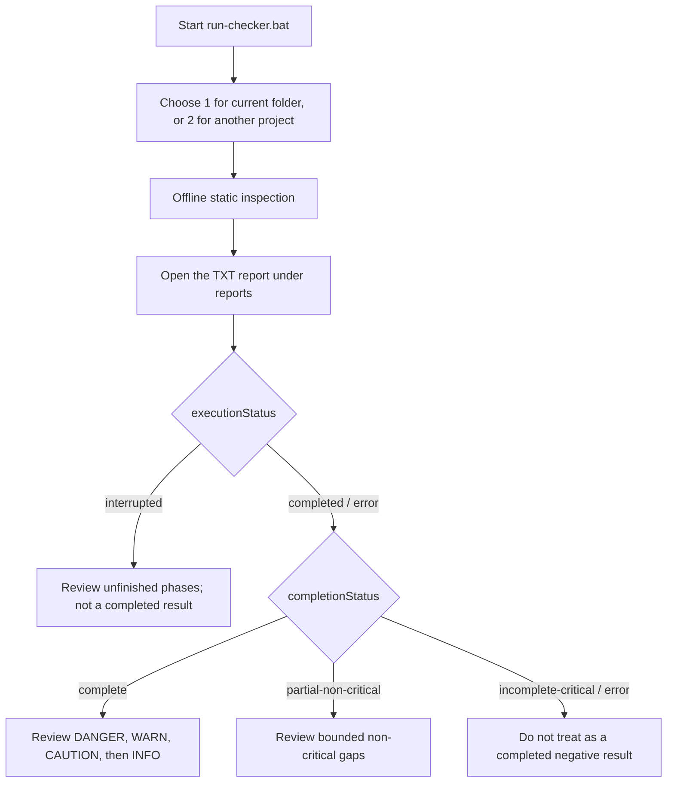

# Illustrated Manual

Use the current diagrams and tables on this page together with [Beginner User Manual](user-manual-en.md) and [Safety Model](safety-model-en.md). Historical Japanese PNGs are linked at the end.

Current scanner version: **0.1.27**. Updated: **2026-10-16**. Menu numbers and scopes are unchanged; labels distinguish current folders, selected folders and confirmed PC scope. Windows PowerShell 5.1 remains the runtime and the October 6 IOC baseline is unchanged.

Version 0.1.27 prints severity totals separately from class totals: `ConfigReview` is not a WARN count. Four reviewed self-test markers receive INFO only with exact path/source-hash/rule verification. Edited sources and other behavior remain analyzed. Menus 3/4/5 include shared checks.

Local IOC timeouts retain the two-second bound and continue later rules with incomplete coverage. MCP extraction limits and malformed command-bearing JSON are coverage gaps. File counters describe distinct paths; `fileEnumerationEvents` / `fileSkipEvents` describe repeat visits. Verified fixture markers no longer inflate project counts or budgets.

`performance.slowActivities` retains at most 20 redacted slow read/file/analysis records alongside `slowSteps`. Timestamps and elapsed time share one origin; sum only `partition=true` activities. Real-PC performance has not been remeasured.

Version 0.1.26 combines original source syntax with proven passive spans to prevent regex-definition false positives. Cached CI settings become INFO references with activation unknown. Custom `_cacache/content-v2` blob subtrees are excluded without decoding; `coverage.summary.nextActions` lists all concurrent coverage actions.

Version 0.1.25 separates execution from severity and coverage. Saved Ctrl+C/pipeline-stop reports show `executionStatus=interrupted` / `INTERRUPTED`, `scanComplete=false` and `completionStatus=incomplete-critical`. Unstarted npm/dependency checks are not reported as not-found or within-limits. Cached MCP commands state that activation is unknown; compressed-data text skips are aggregated into INFO.

Version 0.1.24 distinguishes proven passive regex test literals and planned operations from actual credential-send/configuration-write compounds. INFO does not certify the whole file. For incomplete coverage, inspect `failureType` in `coverage.candidateFailures` / `directoryFailures`: `file-in-use` is a sharing/locking conflict, `access-denied` insufficient access, and `path-too-long` an actual long-path cause. Bounded `exceptionTypes` / `hresults` metadata omits exception messages and contents. Non-critical read failures and dependency/cache sampling limits also set `scanComplete=false` with PARTIAL completion.

## Quick Flow

Use selected checks only when you know which risk area to review. Menu item `2` can optionally use confirmed Deep traversal for dependency, build, and cache internals. Use major or full PC modes only after reading the confirmation prompt.

## Safety Summary

- No external dependencies.
- No network lookup.
- No target code execution.
- No remediation or deletion.
- No secret values in reports.
- UserProfile and EndpointTelemetry modes are opt-in.
- Deep does not add UserProfile, EndpointTelemetry, or npm global/cache and still protects VCS, reparse points, auth contents, and scanner reports.
- `IdeExtensions` includes bounded JetBrains plugin inspection; user-profile roots remain opt-in.
- MajorLocations selects active Codex config, agents, rules, skills, installed plugin tooling, and extension roots, but excludes `.codex\sessions`, runtime cache, and history data; its `scanRoots` does not imply whole-profile coverage.
- MajorLocations also reads static npm global metadata and bounded Program Files, local process-PATH, and version-manager Node.js file metadata.
- `Recommended` statically checks explicit project Node.js versions; broader host scopes add bounded known-path/PATH `node.exe` metadata without executing Node.js.
- Risk-specific menus `3`, `4`, and `5` keep `InvisibleUnicode`/GlassWorm checks enabled. Custom menu `8` remains project-local; use confirmed modes `6`, `7`, or `9` for host scope.
- The `full` launcher profile is comprehensive but bounded: target + major developer locations + profile configuration + endpoint telemetry. It is neither full-disk nor Deep traversal.
- Reports expose `scanScope` and per-dataset `iocData`; `iocData.releaseReady=false` blocks publication readiness without disabling historical exact indicators.

## Result Summary

| Result | Meaning |
|---|---|
| `DANGER` | High-priority candidate. Preserve evidence and review. |
| `WARN` | Higher-priority suspicious pattern, known risk, weakness or coverage limitation. Read the finding type. |
| `CAUTION` | Lower-signal presence, capability, or posture finding to review. |
| `INFO` | Context, inventory, or scanner limitation. |
| `OK` | No candidate for that check or a completion reference. Verify execution and coverage separately. |

For many CAUTION findings, see "Reviewing Many CAUTION Findings" in the [Beginner User Manual](user-manual-en.md). Group findings by category, then review lifecycle conditions, WASM/decoder capability, invisible characters, and configuration context without executing target code.

Node.js upstream `Critical`/`High` version matches are scanner `WARN` (or `INFO` for manifest constraints), not `DANGER` from version evidence alone. `Node.js installed` reports bounded binary metadata separately from `Node.js project refs` such as Dockerfiles and `.nvmrc`. `notAffected` means no match in the shipped offline baseline, not a complete vulnerability or authenticity verdict.

v0.1.15 adds exact Keyv/ChainDrop package-version and structural lockfile matching, bounded hash and startup-setting correlation, and explicit scan-completeness fields. A `DANGER` result is a high-priority triage candidate, not automatic proof of compromise.

## Completion And Blind Spots

Check `execution.phases` for not-started, running, completed, interrupted or failed work. `checkStats` distinguishes enabled checks from their `executionStatus`. `startedAt`, `finishedAt` and `elapsedMs` describe the run; `queuedFilesUnprocessed` counts only already-queued paths, not an unenumerated remainder. Ctrl+C can save a final report when PowerShell runs its finally block; closing the window or killing the process cannot guarantee one.

`findingClassSummary` separates evidence, version matches, configuration review, capabilities, coverage limitations and context. These are finding counts, not infection counts. `REGEX_SCAN_TIMEOUT` adds a stable hashed `ruleId` and timing without regex/input text; `performance.steps` aggregates step timings. Narrowing a folder alone may not fix the same file/rule timeout.

| New field | Interpretation |
|---|---|
| `coverage.summary.nextActions` | Every failure group and sampling limit has its own action; resolving one does not resolve the others. |
| `performance.activities` | Enumeration, project discovery, target selection, reading/decoding and file-processing durations. |
| `partitionElapsedMs` / `otherElapsedMs` | Non-overlapping activity total and remaining execution time; add only entries with `partition=true`. |
| `Reading` / `performance.steps` | Nested details, not additional totals. Report formatting/writes are outside the timing scope. |
| `performance.slowSteps` | At most 20 slowest step/path records at or above two seconds; profile paths are redacted and source text is omitted. |

A timeout can skip the remaining rules in its containing step. Runtime credential-subrule isolation preserves its later execution checks; all recorded timeouts still mean incomplete coverage.

| `completionStatus` | Interpretation |
|---|---|
| `complete` | Planned checks completed inside the selected bounded scope; this is not proof that the host is clean. |
| `partial-non-critical` | A declared non-critical operation or bounded analysis was skipped or limited; review `coverage.summary`. |
| `incomplete-critical` / `error` | Do not use the result as a completed negative. Narrow or rerun the scan and review the recorded gap. |

Each full-text regex operation has a two-second timeout. `REGEX_SCAN_TIMEOUT` skips only that operation for the named file and continues elsewhere, but the run cannot be `complete`; the affected candidate determines whether it is `partial-non-critical` or `incomplete-critical`. This checker is not full-disk, does not inspect memory or live network/process behavior, does not perform a complete online dependency/CVE/provenance audit, and does not prove either infection or safety.

v0.1.16 adds GlassWorm-style Variation Selector decoder and consecutive-cluster detection. Known selector-to-byte mapping is decoded only in memory for static marker checks; decoded text is neither executed nor written to reports.

Generated report folders are not source files and should not be committed or distributed as source. Git ignores only the default repository-root `/reports/`; review custom report directories explicitly.

## Historical PNGs

These Japanese figures were created on 2026-06-29. The main overview shows v0.1.9 and the former four-level severity legend. Use this page's current diagrams and tables for CAUTION, completion, and scope details.

- [Historical overview](assets/dev-supplychain-checker-manual-ja-20260629.png)
- [Historical A4 guide, page 1](assets/dev-supplychain-checker-a4-user-manual-imagegen-ja-page1-20260629.png)
- [Historical A4 guide, page 2](assets/dev-supplychain-checker-a4-user-manual-imagegen-ja-page2-20260629.png)
