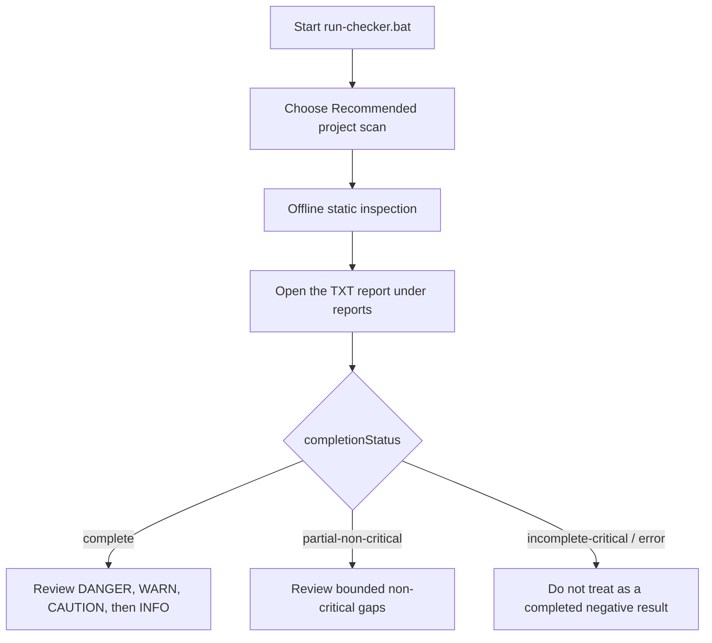

# Illustrated Manual

The current illustrated PNG manuals are Japanese-first user guides. For English distribution, use this page together with [Beginner User Manual](user-manual-en.md) and [Safety Model](safety-model-en.md).

Current scanner version: **0.1.22**. Updated: **2026-08-26**. The launcher menu is unchanged; the launcher now pins Windows PowerShell 5.1, and automatic environment roots are limited to safe children under `USERPROFILE`.

Japanese visual manuals:

- `assets/dev-supplychain-checker-manual-ja-20260629.png`
- `assets/dev-supplychain-checker-a4-user-manual-imagegen-ja-page1-20260629.png`
- `assets/dev-supplychain-checker-a4-user-manual-imagegen-ja-page2-20260629.png`

Those PNGs predate v0.1.22 and may show the former four-level legend or older completion and scope details. The Mermaid flow and result table below are authoritative.

## Quick Flow

Use selected checks only when you know which risk area to review. Menu item `2` can optionally use confirmed Deep traversal for dependency, build, and cache internals. Use major or full PC modes only after reading the confirmation prompt.

## Safety Summary

- No external dependencies.
- No network lookup.
- No target code execution.
- No remediation or deletion.
- No secret values in reports.
- UserProfile and EndpointTelemetry modes are opt-in.
- Deep does not add UserProfile, EndpointTelemetry, or npm global/cache and still protects VCS, reparse points, auth contents, and scanner reports.
- `IdeExtensions` includes bounded JetBrains plugin inspection; user-profile roots remain opt-in.
- MajorLocations selects active Codex config, agents, rules, skills, installed plugin tooling, and extension roots, but excludes `.codex\sessions`, runtime cache, and history data; its `scanRoots` does not imply whole-profile coverage.
- MajorLocations also reads static npm global metadata and bounded Program Files, local process-PATH, and version-manager Node.js file metadata.
- `Recommended` statically checks explicit project Node.js versions; broader host scopes add bounded known-path/PATH `node.exe` metadata without executing Node.js.
- Risk-specific menus `3`, `4`, and `5` keep `InvisibleUnicode`/GlassWorm checks enabled. Custom menu `8` remains project-local; use confirmed modes `6`, `7`, or `9` for host scope.
- The `full` launcher profile is comprehensive but bounded: target + major developer locations + profile configuration + endpoint telemetry. It is neither full-disk nor Deep traversal.
- Reports expose `scanScope` and per-dataset `iocData`; `iocData.releaseReady=false` blocks publication readiness without disabling historical exact indicators.

## Result Summary

| Result | Meaning |
|---|---|
| `DANGER` | High-priority candidate. Preserve evidence and review. |
| `WARN` | Higher-priority suspicious pattern, known risk, or security weakness. |
| `CAUTION` | Lower-signal presence, capability, or posture finding to review. |
| `INFO` | Context, inventory, or scanner limitation. |
| `OK` | Scan completed or no candidate for that check. |

Node.js upstream `Critical`/`High` version matches are scanner `WARN` (or `INFO` for manifest constraints), not `DANGER` from version evidence alone. `Node.js installed` reports bounded binary metadata separately from `Node.js project refs` such as Dockerfiles and `.nvmrc`. `notAffected` means no match in the shipped offline baseline, not a complete vulnerability or authenticity verdict.

v0.1.15 adds exact Keyv/ChainDrop package-version and structural lockfile matching, bounded hash and startup-setting correlation, and explicit scan-completeness fields. A `DANGER` result is a high-priority triage candidate, not automatic proof of compromise.

## Completion And Blind Spots

| `completionStatus` | Interpretation |
|---|---|
| `complete` | Planned checks completed inside the selected bounded scope; this is not proof that the host is clean. |
| `partial-non-critical` | A declared non-critical operation or bounded analysis was skipped or limited; review `coverage.summary`. |
| `incomplete-critical` / `error` | Do not use the result as a completed negative. Narrow or rerun the scan and review the recorded gap. |

Each full-text regex operation has a two-second timeout. `REGEX_SCAN_TIMEOUT` skips only that operation for the named file and continues elsewhere, but the run cannot be `complete`; the affected candidate determines whether it is `partial-non-critical` or `incomplete-critical`. This checker is not full-disk, does not inspect memory or live network/process behavior, does not perform a complete online dependency/CVE/provenance audit, and does not prove either infection or safety.

v0.1.16 adds GlassWorm-style Variation Selector decoder and consecutive-cluster detection. Known selector-to-byte mapping is decoded only in memory for static marker checks; decoded text is neither executed nor written to reports.

Generated report folders are not source files and should not be committed or distributed as source. Git ignores only the default repository-root `/reports/`; review custom report directories explicitly.
