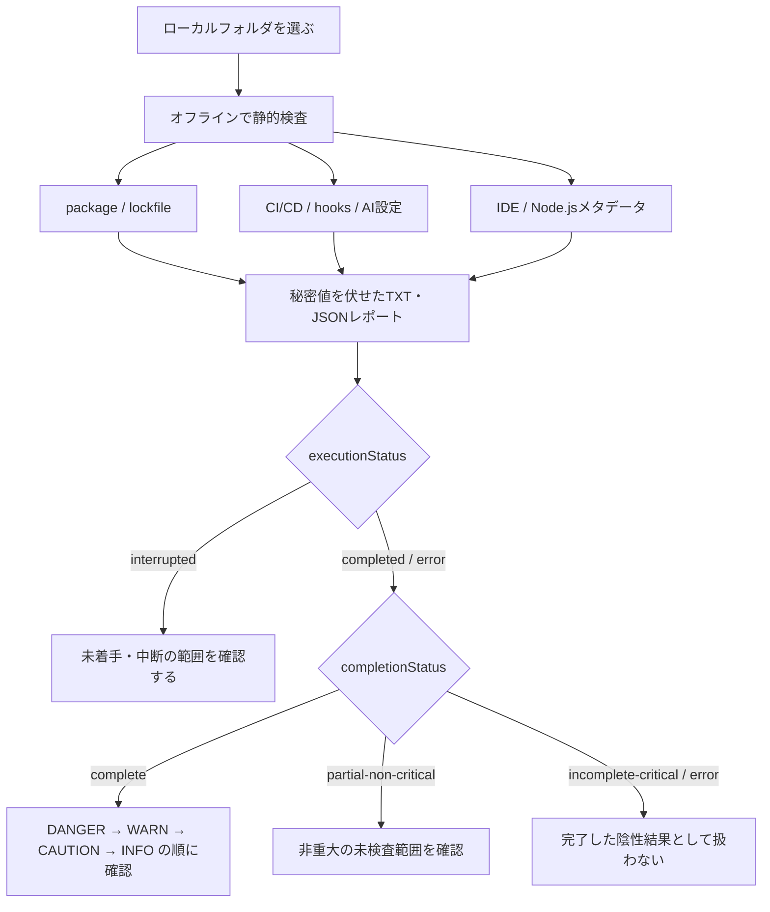

# 図解マニュアル: Dev Supply Chain IOC Checker

対象: Windowsで開発用フォルダや主要な開発環境を安全に確認したい人
対象バージョン: **0.1.27**。更新日: **2026-10-16**。

v0.1.27は重大度別件数を併記します。`ConfigReview` は分類で、WARN件数は `Findings by severity` を見ます。自己テスト参照4件はパス・内容ハッシュ・ルールの一致時だけINFOです。変更されたファイルとほかの挙動は通常検査します。メニュー3・4・5には共通検査も含まれます。

ローカルIOCのタイムアウト後も後続ルールを続け、MCP解析の上限や不正JSONも未完了へ記録します。件数は重複を除いたパス数、再訪は `fileEnumerationEvents` / `fileSkipEvents` です。検証済みサンプルの目印はプロジェクト数・予算から外し、未知・改変ファイルは残します。

`performance.slowActivities` は遅い読み取り・ファイル処理・解析の上位20件です。`slowSteps` と合わせて原因を絞ります。時刻と経過時間の起点をそろえ、合計には `partition=true` の活動だけを使います。実PCの速度は再測定していません。メニュー範囲と2026-10-06のIOC基準は維持します。

v0.1.26は、元ソースの構文と検査用文字列の根拠を組み合わせ、正規表現定義を実行コードと取り違える誤検知を修正します。キャッシュ内のCI設定は有効化不明の参考情報としてINFOへ分類します。`_cacache\content-v2` の本文は独自配置でも除外し、同時に発生した未完了理由を `coverage.summary.nextActions` にすべて表示します。メニュー番号・範囲とIOC基準は変わりません。

v0.1.25では、重大度と `Execution`（実行状態）を分けます。Ctrl+C中断時に保存できた結果は `interrupted` / `INTERRUPTED` です。未着手のnpm検査は `not-started` と表示します。キャッシュ内のMCP設定は有効化不明として扱い、圧縮データの本文スキップはINFOへ集約します。

v0.1.24は、受動的な検査用文字列と実際の送信・設定書込を区別する精度を改善します。INFOの根拠があってもファイル全体が安全とは断定しません。未完了時は `coverage.candidateFailures` / `directoryFailures` の `failureType` を確認します。`file-in-use` は占有、`access-denied` はアクセス拒否、`path-too-long` は長いパスの例外原因です。`exceptionTypes` / `hresults` は補助メタデータで、例外メッセージは出しません。非重大の読取失敗や依存関係・キャッシュの検査上限でも `scanComplete=false` とPARTIALになります。

下の図と表が現行の手順です。メニュー番号は変わらず、`2. Scan selected path` のパス入力後に通常の `Recommended` または確認必須の `Deep` を選べます。v0.1.23で追加した2026-10-06のIOC、native build/runtime経路、Pythonメタデータの照合も引き続き使います。5段階の重要度、Node.jsの端末・プロジェクト別表示、`PARTIAL (non-critical)` を使って結果を確認します。

旧PNGは末尾の履歴資料へ分けています。現在の操作は、このページのMermaid図・本文と[初心者向けマニュアル](user-manual-ja.md)を参照してください。

安全性の説明だけを配布先へ渡したい場合は、[安全性と設計上の約束](safety-model-ja.md)も参照してください。

現在の処理の流れは次の通りです。



## 1. このツールでできること

このツールは、開発用フォルダやAIエージェント設定、IDE拡張、CI/CD設定などに「注意すべき痕跡」がないかを静的に確認します。

重要な特徴:

- インターネットには接続しません。
- npm、pip、python、node などを実行しません。
- 対象プロジェクトのコードを実行しません。
- ファイル削除、修復、隔離、アンインストールはしません。
- 認証ファイルの中身やトークン値はレポートに出しません。
- ユーザープロファイルや端末ログを見るモードは、明示的に選んだ時だけ動きます。

つまり、このツールは「安全に読むだけ」の一次確認ツールです。

## 2. 最初に使うおすすめモード

まずは `run-checker.bat` をダブルクリックしてください。メニューが出ます。

```text
1. Recommended project scan
2. Scan selected path
3. Package / Node runtime risks
4. AI / MCP / IDE config risks only
5. CI/CD and hooks risks only
6. npm global/cache static check
7. Major PC locations scan
8. Custom checks for current folder
9. Comprehensive bounded scan (target + major locations + profile + endpoint)
10. Exit
```

初心者向けの選び方:

| やりたいこと | 選ぶ番号 | 補足 |
|---|---:|---|
| 今開いているプロジェクトだけ確認したい | 1 | 最初はこれがおすすめ |
| 別のフォルダを指定して確認したい | 2 | パスを入力します |
| 依存関係とNode.jsを確認したい | 3 | package.json、lockfile、明示バージョン＋不可視Unicode |
| AI/MCP/IDE設定だけ確認したい | 4 | agent 設定や VS Code 互換拡張＋不可視Unicode |
| CI/CDやhooksだけ確認したい | 5 | GitHub Actions や hooks＋不可視Unicode |
| npm global/cache を静的に確認したい | 6 | 実行前に `YES` 確認があります |
| PC内の主要な開発場所だけ広めに確認したい | 7 | 実行前に `YES` 確認があります |
| 現在フォルダ用のチェックを組み合わせたい | 8 | 実PC範囲は追加しません |
| 端末ログやDNSキャッシュなども含めたい | 9 | 詳しい人や管理者と一緒に使うのがおすすめ |

通常は、まず `1` か `2` で対象プロジェクトだけを確認してください。

`Deep` は依存・build・cache内部まで読む高負荷モードです。自動的にPC全体や端末ログを追加するものではなく、VCS、reparse point、認証ファイル本文、このツール自身のreportsは引き続き保護されます。

## 3. 一番安全な基本手順

1. 調べたいプロジェクトフォルダをエクスプローラーで開きます。
2. このツールの `run-checker.bat` を起動します。
3. メニューで `2` を選び、調べたいプロジェクトのフルパスと `1. Recommended traversal` を入力します。
4. スキャンが終わるまで待ちます。
5. `reports` フォルダに作成された `.txt` レポートを開きます。
6. まず `Execution` と `Completion`、次に `[SUMMARY]` と `[PRIORITY FINDINGS]` を確認します。

`1` は起動時の現在作業フォルダが対象です。BATのダブルクリックではチェッカー自身のフォルダになることがあります。`2` は指定フォルダ、`3`・`4`・`5`・`8` は現在作業フォルダ、`6`・`7`・`9` は確認を伴うPC側の検査です。番号と実際の検査範囲は変更していません。

レポート例:

```text
OverallResult: CAUTION
Execution: completed; UnfinishedPhases=
Completion: COMPLETE; ScanComplete=True
Node.js installed: inspected=1; evaluated=1; vulnerable=0; notAffected=1; readFailures=0
Node.js project refs: observed=1; evaluated=1; vulnerable=1; notAffected=0; unresolved=0

[SUMMARY]
DANGER: 0
WARN:   0
CAUTION: 1
INFO:   3
OK:     1
```

## 4. レポートの見方

重要度は次の5種類です。

| 表示 | 意味 | 最初にすること |
|---|---|---|
| `DANGER` | 強く確認すべき候補 | 削除せず、内容と場所を確認 |
| `WARN` | 不審パターン、既知リスク、弱い設定、重要な検査制限 | 種類と理由を優先して読む |
| `CAUTION` | 単独では低信号の存在・能力・設定 | 用途と有効化の有無を確認 |
| `INFO` | 参考情報 | 必要に応じて確認 |
| `OK` | 対象チェックの候補なし等の参考結果 | 実行・完了状態も確認 |

`DANGER` は「感染確定」ではありません。ただし、優先して確認すべきサインです。

### 完了状態と見えない範囲

| `completionStatus` | 受け止め方 |
|---|---|
| `complete` | 選択した境界内の予定検査が完了。PC全体が安全という意味ではありません。 |
| `partial-non-critical` | 非重大とした処理または境界内解析の一部が未完了。`coverage.summary` を確認します。 |
| `incomplete-critical` / `error` | 完了した陰性結果として扱いません。記録された不足を確認し、対象を狭めて再実行します。 |

本文の各正規表現処理は2秒で打ち切ります。`REGEX_SCAN_TIMEOUT` の後も他の検査とファイルは続行しますが、該当ステップの残りは省略される場合があり、結果は `complete` になりません。runtimeコードの秘密情報取得サブルールでは後続の取得・実行検査を維持します。対象が非重大候補なら `partial-non-critical`、重大候補なら `incomplete-critical` です。このツールはディスク全体、メモリ、実行中process、実通信、全依存関係・全CVE、オンラインでの発行元・真正性を検査せず、感染も安全も確定しません。

## 5. まず見るべき場所

TXTレポートでは、次の順に見ると分かりやすいです。

1. `[SUMMARY]`
2. `[PRIORITY FINDINGS]`
3. `[CAPABILITY SUMMARY]`
4. `[FINDINGS]`

`[PRIORITY FINDINGS]` は、特に優先して確認すべきものを上に集めた欄です。

優先される代表例:

- 既知の危険IOCに一致したもの
- トークンや認証情報を外部に送る疑いがあるもの
- 実行設定の中に外部取得して実行するパターンがあるもの

`[CAPABILITY SUMMARY]` は、Codex skill や plugin などが外部API、ダウンロード、インストール、書き込み機能を持つ場合の集約です。これは感染証拠ではありませんが、そのツールを使う前に提供元や用途を確認するための情報です。

## 6. finding の項目

各 finding には、次のような情報が出ます。

| 項目 | 意味 |
|---|---|
| `Category` | 何を検出したか |
| `Path` | 見つかった場所 |
| `Line` | 何行目付近か。空の場合もあります |
| `SourceContext` | 通常ファイル、AI設定、実行スクリプト、cache、検証sampleなどの文脈 |
| `RiskType` | リスクの種類 |
| `Confidence` | 確度。`high`、`medium`、`low` |
| `Check` | どの検査種類で見つかったか |
| `DetectionMethod` | 静的ファイル、静的パス、metadata、inventory など |
| `Evidence` | 秘密値を伏せた根拠 |
| `Recommendation` | 次に確認すること |

`RiskType` の見方:

| RiskType | 意味 |
|---|---|
| `known-ioc` | 既知の危険指標に近い |
| `active-exfil` | 認証情報の外部送信が疑われる |
| `fetch-execute` | 外部取得して実行する形に近い |
| `capability` | 外部API、インストール、書き込み機能を持つ |
| `posture` | 設定上の注意点 |
| `inventory` | 存在確認 |
| `limitation` | スキャン上の制限や補足 |

## 7. DANGER が出た時

まず、次のことはしないでください。

- 見つかったファイルを削除する
- URLにアクセスする
- npm、pip、python、node などを実行する
- トークンや認証ファイルをチャットに貼る
- 拡張機能やツールを慌ててアンインストールする

推奨手順:

1. レポートの `.txt` と `.json` を残します。
2. `Path` に書かれた場所を確認します。
3. ファイルを実行せず、内容を読むだけにします。
4. `Category`、`RiskType`、`Evidence` を確認します。
5. 業務PCなら、IT管理者やセキュリティ担当に相談します。

## 8. WARN が出た時

`WARN` は「すぐ危険確定」ではありません。

`findingClassSummary` は「指標・挙動」「バージョン照合」「設定確認」「機能」「検査制限」「参考情報」に分けます。`SCAN_INTERRUPTED` や検査上限のWARNは検査制限です。`execution.phases` の `not-started` は未着手、`interrupted` は中断、`failed` は処理失敗です。中断時の `completionStatus` は既存の `incomplete-critical` になり、重大候補の処理を完了したとは判断しません。

`queuedFilesUnprocessed` は列挙済みの未処理件数で、未列挙の範囲は含みません。`startedAt`・`finishedAt`・`elapsedMs` で実行時間を確認できます。Ctrl+Cでも終了処理を実行できた場合にレポートを保存します。ウィンドウを閉じる操作では保存を保証できません。

`REGEX_SCAN_TIMEOUT` は `ruleId` と時間を記録し、本文や正規表現は表示しません。`performance.steps` に遅い検査の集計があります。同じファイルのタイムアウトは、対象フォルダを絞るだけでは直らない場合があります。

| 新しい確認項目 | 読み方 |
|---|---|
| `coverage.summary.nextActions` | サイズ超過・タイムアウト・検査上限などの対処一覧。1つ直しても別の理由が残る場合があります。 |
| `performance.activities` | 列挙、子プロジェクト探索、依存候補選択、本文の読み取り・解読、ファイル処理の時間。 |
| `partitionElapsedMs` / `otherElapsedMs` | 重複しない活動の合計と、それ以外の実行時間。`partition=true` の項目だけを合計します。 |
| `Reading` / `performance.steps` | 他の活動に含まれる内訳です。合計へ再加算しません。レポート整形・書き込みは計時対象外です。 |
| `performance.slowSteps` | 2秒以上の遅い検査を最大20件、遅い順に記録します。パスは伏せ字化し、本文は含めません。 |

Node.jsの公式`Critical`/`High`にバージョンが一致した場合も、このツールでは原則`WARN`です。これは上流の脆弱性深刻度と、実際にそのPC/プロジェクトで悪用可能かという判断を混同しないためです。`Node.js installed` はグローバル／既知配置のバイナリ、`Node.js project refs` はDockerfileや`.nvmrc`などの指定です。後者の警告だけなら、インストール済みNode.jsが古いという意味ではありません。`notAffected` は同梱オフライン基準に一致しなかったという限定的な結果です。

よくある `WARN` の例:

- MCPやAIエージェント設定で `npx` が未固定
- GitHub Actions の権限が広い
- C2やdecoderに似た文字列が実行文脈にある
- 変更可能な外部参照や実行フックに具体的なリスクがある

確認ポイント:

- そのファイルは自分が入れたものか
- そのツールやpluginは信頼できる提供元か
- バージョン固定されているか
- 外部送信先が自分の想定どおりか

## 9. CAUTION が出た時

件数が多い場合は、[初心者向けマニュアル](user-manual-ja.md)の「CAUTIONが多い場合の精査」で、カテゴリ別の集計コマンドとライフサイクルスクリプト・WASM・不可視文字の確認点を参照してください。

`CAUTION` は確認を勧める低信号の候補です。単独では感染や悪用を示しません。

よくある例:

- package.json にライフサイクルスクリプトがある
- 単独の不可視Unicode文字がある
- 悪性複合条件のないWASMリモート読込機能がある
- IDE拡張にWASMやnative artifactがある

`WARN` と `CAUTION` はどちらも終了コード `1` ですが、確認順は `WARN` が先です。

## 10. INFO が出た時

`INFO` は参考情報です。

例:

- 認証ファイルが存在する
- npm cache blob を本文スキャン対象から除外した
- GitHub APIを読むために `GITHUB_TOKEN` を使うコードがある
- このツール自身の検証sampleを親スキャンでスキップした

`INFO` だけなら、通常は慌てる必要はありません。

## 11. `tests/samples` について

このリポジトリには `tests/samples` という検証用フォルダがあります。

ここには、検出動作を確認するための作り物ファイルが入っています。

- 実マルウェアではありません。
- 外部から危険ファイルをダウンロードしたものではありません。
- 偽のURLや偽のトークン表現が含まれます。
- 直接スキャンすると `DANGER`、`WARN`、`CAUTION` が出るのは正常です。

親フォルダや Major PC locations scan では、このツール自身の manifest で確認できた既知sampleだけをスキップします。

重要:

- 他のプロジェクトの `tests/samples` は自動的に信用しません。
- 未知ファイルや改変されたsampleはスキップせず通常スキャンします。

## 12. Major PC locations scan の意味

`7. Major PC locations scan` は、PC全体を総当たりする機能ではありません。

主に見る場所:

- `CodexProjects`
- `Projects`
- `source\repos`
- `repos`
- `dev`
- `workspace`
- `Documents\GitHub`
- `Desktop\GitHub` / `Desktop\Projects` / `Desktop\repos`
- `IdeaProjects` / `PyCharmProjects` / `AndroidStudioProjects` など主要IDEの既定プロジェクトフォルダ
- OneDrive / OneDriveCommercial / OneDriveConsumer 配下の限定プロジェクトサブフォルダ
- VS Code / Cursor / Windsurf などの拡張機能
- ユーザー領域のJetBrainsプラグイン（Major/UserProfileを明示した場合）
- Claude / Cursor / Codex などのAIエージェント設定
- Codex の agents / rules / skills / 導入済みプラグインの実行コード
- npm global package の静的メタデータ
- Program Files / PATH / version manager 上の限定Node.jsメタデータ
- 認証ファイルの存在確認

見ないもの:

- `C:\` 全体
- `C:\Windows` 全体
- `Program Files` 全体
- `.codex\sessions`、Codex の実行時cache、履歴データ
- 端末ログ、DNSキャッシュ、イベントログ

端末ログやDNSキャッシュまで見る場合は `9. Comprehensive bounded scan` ですが、初心者は詳しい人と一緒に使うのがおすすめです。9番は7番の主要開発場所も含みますが、ディスク全体やDeep対象を再帰走査する機能ではありません。

レポートの `scanRoots` にはモード7で実際に存在した設定・拡張機能・ツールのルートだけが入り、ユーザープロファイル全体を意味する `~` は入りません。`scanScope` には実際に含んだ範囲と除外範囲、`iocData` には各IOCファイルの更新日・期限・公開可否が入ります。`iocData.releaseReady=false` の場合、スキャンは続行できますが、公開版のIOCデータは再確認が必要です。

## 13. コマンドで使う場合

通常はBATメニューで十分です。

コマンドで使う場合:

```bat
run-checker.bat current C:\Path\To\Project
```

主要箇所だけ見る場合:

```bat
run-checker.bat major
```

PowerShellから直接実行する場合:

```powershell
powershell.exe -NoLogo -NoProfile -ExecutionPolicy Bypass -File .\Scan-DevSupplyChain.ps1 -Path C:\Path\To\Project -ReportDir .\reports
```

検査種類を指定する場合:

```powershell
powershell.exe -NoLogo -NoProfile -ExecutionPolicy Bypass -File .\Scan-DevSupplyChain.ps1 -Path C:\Path\To\Project -Checks Packages,AiMcp,CiCd -ReportDir .\reports
```

## 14. GitHubリポジトリを確認したい場合

このツールはオフライン専用です。GitHubへ直接アクセスしてダウンロードする機能はありません。`git clone`、`git archive`、GitHub API 取得機能も実装していません。

確認したい場合は、すでにPC上にあるローカルフォルダを指定してください。

例:

```bat
run-checker.bat current C:\Users\yourname\Documents\GitHub\some-repo
```

## 15. 最後の判断

このツールの結果は、次のように受け止めてください。

- `DANGER`: 優先して確認する候補
- `WARN`: より強い不審パターンや既知リスクを確認する候補
- `CAUTION`: 低信号の存在・能力・設定を確認する候補
- `INFO`: 状況理解のための補足
- `OK`: スキャン完了または問題候補なし

このツールは感染を確定するものでも、完全な安全を証明するものでもありません。安全に一次確認し、次に見るべき場所を絞るための道具です。

## 旧版のPNG（履歴資料）

以下は2026-06-29の図版です。主図にはv0.1.9と旧4段階の重要度があり、現行のCAUTION、完了状態、探索範囲を説明する資料としては使いません。現在の使い方は本ページの図と表を参照してください。

- [旧版の概要図](assets/dev-supplychain-checker-manual-ja-20260629.png)
- [旧版のA4図解・1ページ目](assets/dev-supplychain-checker-a4-user-manual-imagegen-ja-page1-20260629.png)
- [旧版のA4図解・2ページ目](assets/dev-supplychain-checker-a4-user-manual-imagegen-ja-page2-20260629.png)
